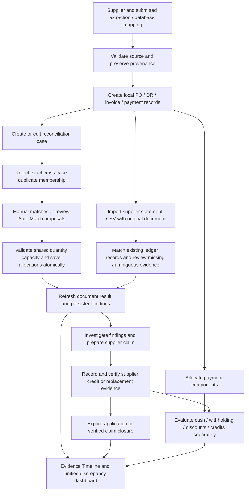
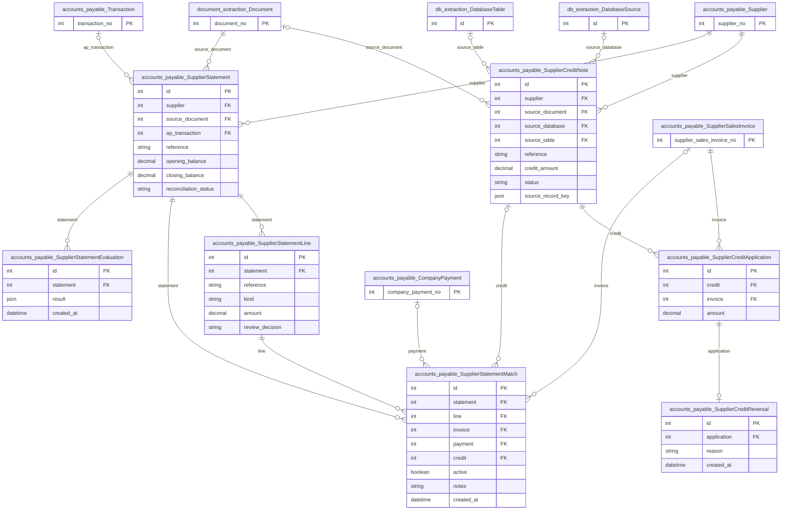
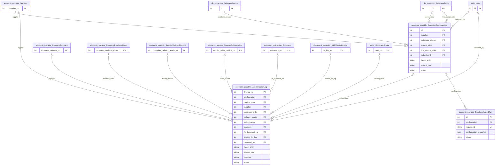

# Accounts payable

Owns supplier-side documents, quantity matching, payments, verified supplier credits
and statement reconciliation. AP and AR retain independent business models and
reconciliation validators while sharing accounting workspace/services through `mode="ap"`.

## Application flow



## Setup and daily workflow

Run the project migrations and bind development Django to loopback:

```bash
python auditcounter_django/manage.py migrate
python auditcounter_django/manage.py runserver 127.0.0.1:8000
```

Open `/accounts-payable/`. Create the supplier first, configure extraction through
[Record First setup](../accounts_receivable/SETUP.md), review and submit the mapping,
then route documents or review/confirm a read-only database import. Configure
`ACCOUNTS_PAYABLE_*` for record extraction and `CONFIG_ASSISTANT_*` for mapping
assistance in `auditcounter_django/.env`. Database credentials belong in Database
connections; see its [credential instructions](../db_extraction/README.md).

Open a reconciliation case, choose source documents, review line allocations, and
save with its current revision. One invoice line may allocate across several accepted
receipts; other cases' allocations consume the same capacity. Overlapping document
sets are allowed when valid; exact duplicate sets are blocked before saved matches
are changed. Price differences preserve supported physical quantities.

## Important financial rules

- `Transaction.reconciliation_status` is computed from PO/DR/SI evidence. Human
  finding reviews and investigation closure do not assign that result.
- Only accepted receiving quantities support invoice quantity allocations. A PO's
  remaining delivery balance is not automatically an invoice discrepancy.
- Settlement reports cash, withholding, discounts, applied credits, reservations and
  outstanding amounts separately. Pending/reversed payments do not settle invoices.
- Credit notes require evidence and explicit verification, then explicit partial/full
  application. Applications and reversals preserve history; account-first locks prevent
  payments and credits consuming the same invoice balance concurrently.
- Statement matches verify ledger evidence; they never create or apply a missing credit.
- Potential discrepancies and accepted claims are not automatically cash recovery.
  Keep currencies separate; no exchange-rate conversion is implemented.

## Main pages and actions

| Route / shared API action | Purpose |
|---|---|
| `/accounts-payable/reconciliation/<id>/` | Existing case, findings, investigation, settlement and timeline |
| `/accounts-payable/reconciliation/<id>/match/` | Manual allocations and Auto Match proposals |
| `/accounts-payable/credits/` | Manual credit register, verification, application and reversals |
| `/accounts-payable/statements/` | Structured CSV statement input and ledger review |
| `credit-create`, `credit-verify/<id>`, `credit-apply/<id>`, `credit-reverse/<application_id>` | Explicit credit writes under `/accounts-payable/api/` |
| `statement-create`, `statement-reconcile/<id>`, `statement-review/<id>` | Statement writes |
| `claim-create/<case_id>`, `claim-transition/<id>`, `claim-correspondence/<id>`, `claim-resolve/<id>` | Supplier claims within existing AP investigations |

Accounting API actions use POST, JSON and CSRF, preserving server revision checks.
For complete shared configuration, import and case APIs, see [AR's backend guide](../accounts_receivable/README.md).

## Code and tests

`services/reconciliation.py` owns AP validation; `credits.py` owns verified credit
capacity/application/reversal; `statements.py` owns statement validation/matching and
source-change refresh. Shared services live in `accounts_receivable/services/`.
Findings, claims, reviewed causes and investigations live in [Discrepancies](../discrepancies/README.md).

```bash
python auditcounter_django/manage.py test accounts_payable accounts_receivable discrepancies --noinput
```

Use a disposable PostgreSQL application database for locking/concurrency tests;
SQLite skips those tests. No application login is required. Credits currently support
manual entry with uploaded evidence; statements support structured CSV text with an
uploaded original, up to 500 lines. Credit extraction and Excel/PDF statement parsing
are not exposed. See [MVP implementation and migration notes](../../docs/mvp-implementation-report.md).

## Model ERD

These logical diagrams reflect the current Django model definitions. Key fields are
shown; external entities appear as primary-key stubs and include their app prefix.
`||` means exactly one, `|o` / `o|` zero or one, and `o{` / `}o` zero or more.
FK optionality is represented on the parent side; one-to-one/unique FKs limit children.
Many-to-many lines represent Django-managed join tables; service validation may impose
stronger business constraints than these structural cardinalities.

### Documents, lines and matching

```mermaid
erDiagram
    accounts_payable_Supplier {
        int supplier_no PK
        string supplier_code UK
        string supplier_name
        string tax_identification_no
    }
    accounts_payable_CompanyPurchaseOrder {
        int company_purchase_order PK
        int supplier FK
        int source_table FK
        int source_llm_log FK
        int source_text_log FK
        int source_document FK
        int source_database FK
        string po_reference_no UK
        decimal subtotal
        decimal discount_amount
        decimal tax_amount
        decimal total_amount
        decimal other_charges
    }
    accounts_payable_SupplierDeliveryReceipt {
        int supplier_delivery_receipt_no PK
        int supplier FK
        int receiving_evidence FK
        int source_table FK
        int source_llm_log FK
        int source_text_log FK
        int source_document FK
        int source_database FK
        string dr_reference_no
        string receipt_status
        json source_record_key
    }
    accounts_payable_SupplierSalesInvoice {
        int supplier_sales_invoice_no PK
        int supplier FK
        int source_table FK
        int source_llm_log FK
        int source_text_log FK
        int source_document FK
        int source_database FK
        string invoice_reference_no
        decimal subtotal
        decimal discount_amount
        decimal tax_amount
        decimal other_charges
        decimal total_amount
    }
    accounts_payable_CompanyPayment {
        int company_payment_no PK
        int supplier FK
        int proof_of_payment FK
        int source_table FK
        int source_llm_log FK
        int source_text_log FK
        int source_document FK
        int source_database FK
        string payment_reference_no
        string bank_reference_no
        decimal amount_paid
        decimal withholding_tax_amount
        decimal discount_taken
        string payment_status
    }
    accounts_payable_Transaction {
        int transaction_no PK
        int supplier FK
        string reconciliation_status
        decimal total_discrepancy_amount
    }
    accounts_payable_CompanyPurchaseOrderLine {
        int id PK
        int purchase_order FK
        string item_code
        decimal quantity_ordered
        decimal unit_price
        decimal discount_amount
        decimal tax_amount
        decimal line_total
    }
    accounts_payable_SupplierDeliveryReceiptLine {
        int id PK
        int delivery_receipt FK
        string item_code
        decimal quantity_stated
        decimal quantity_received
        decimal quantity_accepted
        decimal quantity_rejected
    }
    accounts_payable_SupplierSalesInvoiceLine {
        int id PK
        int invoice FK
        string item_code
        decimal quantity_invoiced
        decimal unit_price
        decimal discount_amount
        decimal tax_amount
        decimal line_total
    }
    accounts_payable_DocumentMatch {
        int id PK
        int transaction FK
        int purchase_order_line FK
        int delivery_receipt_line FK
        int invoice_line FK
        decimal matched_quantity
        string match_status
    }
    accounts_payable_PaymentAllocation {
        int id PK
        int payment FK
        int invoice FK
        decimal cash_amount
        decimal withholding_tax_amount
        decimal discount_amount
    }
    db_extraction_DatabaseSource {
        int id PK
    }
    db_extraction_DatabaseTable {
        int id PK
    }
    document_extraction_DocExtractionLog {
        int doc_log_no PK
    }
    document_extraction_Document {
        int document_no PK
    }
    document_extraction_LLMExtractionLog {
        int llm_log_no PK
    }
    accounts_payable_Supplier ||--o{ accounts_payable_CompanyPurchaseOrder : "supplier"
    db_extraction_DatabaseTable |o--o{ accounts_payable_CompanyPurchaseOrder : "source_table"
    document_extraction_LLMExtractionLog |o--o{ accounts_payable_CompanyPurchaseOrder : "source_llm_log"
    document_extraction_DocExtractionLog |o--o{ accounts_payable_CompanyPurchaseOrder : "source_text_log"
    document_extraction_Document |o--o{ accounts_payable_CompanyPurchaseOrder : "source_document"
    db_extraction_DatabaseSource |o--o{ accounts_payable_CompanyPurchaseOrder : "source_database"
    accounts_payable_Supplier |o--o{ accounts_payable_SupplierDeliveryReceipt : "supplier"
    document_extraction_Document |o--o{ accounts_payable_SupplierDeliveryReceipt : "receiving_evidence"
    db_extraction_DatabaseTable |o--o{ accounts_payable_SupplierDeliveryReceipt : "source_table"
    document_extraction_LLMExtractionLog |o--o{ accounts_payable_SupplierDeliveryReceipt : "source_llm_log"
    document_extraction_DocExtractionLog |o--o{ accounts_payable_SupplierDeliveryReceipt : "source_text_log"
    document_extraction_Document |o--o{ accounts_payable_SupplierDeliveryReceipt : "source_document"
    db_extraction_DatabaseSource |o--o{ accounts_payable_SupplierDeliveryReceipt : "source_database"
    accounts_payable_Supplier |o--o{ accounts_payable_SupplierSalesInvoice : "supplier"
    db_extraction_DatabaseTable |o--o{ accounts_payable_SupplierSalesInvoice : "source_table"
    document_extraction_LLMExtractionLog |o--o{ accounts_payable_SupplierSalesInvoice : "source_llm_log"
    document_extraction_DocExtractionLog |o--o{ accounts_payable_SupplierSalesInvoice : "source_text_log"
    document_extraction_Document |o--o{ accounts_payable_SupplierSalesInvoice : "source_document"
    db_extraction_DatabaseSource |o--o{ accounts_payable_SupplierSalesInvoice : "source_database"
    accounts_payable_Supplier |o--o{ accounts_payable_CompanyPayment : "supplier"
    document_extraction_Document |o--o{ accounts_payable_CompanyPayment : "proof_of_payment"
    db_extraction_DatabaseTable |o--o{ accounts_payable_CompanyPayment : "source_table"
    document_extraction_LLMExtractionLog |o--o{ accounts_payable_CompanyPayment : "source_llm_log"
    document_extraction_DocExtractionLog |o--o{ accounts_payable_CompanyPayment : "source_text_log"
    document_extraction_Document |o--o{ accounts_payable_CompanyPayment : "source_document"
    db_extraction_DatabaseSource |o--o{ accounts_payable_CompanyPayment : "source_database"
    accounts_payable_Supplier |o--o{ accounts_payable_Transaction : "supplier"
    accounts_payable_Transaction }o--o{ accounts_payable_CompanyPurchaseOrder : "purchase_orders"
    accounts_payable_Transaction }o--o{ accounts_payable_SupplierDeliveryReceipt : "delivery_receipts"
    accounts_payable_Transaction }o--o{ accounts_payable_SupplierSalesInvoice : "sales_invoices"
    accounts_payable_CompanyPurchaseOrder ||--o{ accounts_payable_CompanyPurchaseOrderLine : "purchase_order"
    accounts_payable_SupplierDeliveryReceipt ||--o{ accounts_payable_SupplierDeliveryReceiptLine : "delivery_receipt"
    accounts_payable_SupplierSalesInvoice ||--o{ accounts_payable_SupplierSalesInvoiceLine : "invoice"
    accounts_payable_Transaction ||--o{ accounts_payable_DocumentMatch : "transaction"
    accounts_payable_CompanyPurchaseOrderLine |o--o{ accounts_payable_DocumentMatch : "purchase_order_line"
    accounts_payable_SupplierDeliveryReceiptLine |o--o{ accounts_payable_DocumentMatch : "delivery_receipt_line"
    accounts_payable_SupplierSalesInvoiceLine ||--o{ accounts_payable_DocumentMatch : "invoice_line"
    accounts_payable_CompanyPayment ||--o{ accounts_payable_PaymentAllocation : "payment"
    accounts_payable_SupplierSalesInvoice ||--o{ accounts_payable_PaymentAllocation : "invoice"
```



### Credits and statement evidence



### Extraction and import provenance



### Model responsibilities

| Model | Responsibility |
|---|---|
| `Supplier` | Supplier master identity and payment terms. |
| `CompanyPurchaseOrder` | Company purchase order to a supplier. |
| `SupplierDeliveryReceipt` | Supplier delivery evidence. |
| `SupplierSalesInvoice` | Supplier invoice and local settlement state. |
| `CompanyPayment` | Company payment to a supplier; cash, withholding and discounts remain distinct. |
| `Transaction` | Existing reconciliation case joining document sets; AP and AR are separate namespaces. |
| `CompanyPurchaseOrderLine` | Original line identity, product/unit and quantity/price values; linked matching allocations preserve source evidence. |
| `SupplierDeliveryReceiptLine` | Original line identity, product/unit and quantity/price values; linked matching allocations preserve source evidence. |
| `SupplierSalesInvoiceLine` | Original line identity, product/unit and quantity/price values; linked matching allocations preserve source evidence. |
| `DocumentMatch` | One quantity allocation across invoice/order/receipt lines; split deliveries are supported. |
| `PaymentAllocation` | Payment components allocated to one invoice. |
| `ExtractionConfiguration` | Draft/submitted extraction or database mapping and reviewed snapshots. |
| `LLMExtractionLog` | Provider/configuration request and response metadata, source/configuration snapshot and outcome. |
| `DatabaseImportRun` | Local import/update request identity, configuration snapshot and outcomes. |
| `SupplierCreditNote` | Draft or verified supplier correction with original evidence. |
| `SupplierCreditApplication` | Immutable partial application of verified credit to an invoice. |
| `SupplierCreditReversal` | Explicit reversal retaining the original credit application. |
| `SupplierStatement` | Supplier statement header, balances, provenance and optional case link. |
| `SupplierStatementLine` | Original invoice/payment/credit statement entry and current review. |
| `SupplierStatementMatch` | Explicit ledger target; superseded relationships remain historical. |
| `SupplierStatementEvaluation` | Append-only statement reconciliation observation. |

For every field, delete policy, conditional constraint and index, consult
[`models.py`](models.py) and the additive [`migrations/`](migrations/). These diagrams
do not imply that an unmigrated database already has the same schema.
