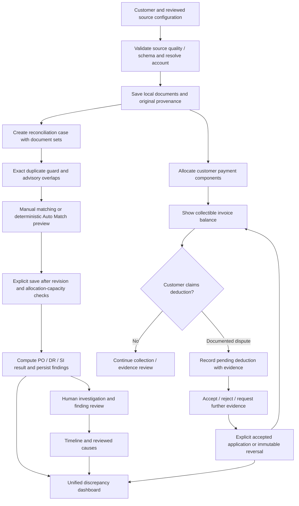
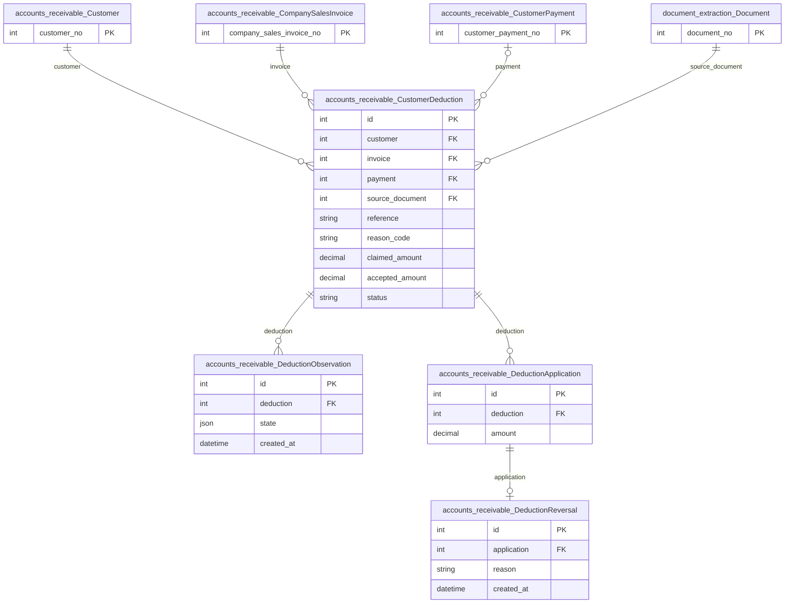

# Accounts receivable and shared accounting services

Owns customer-side PO/DR/invoice/payment records, matching and reviewed deductions.
It also hosts shared AP/AR workspace, setup, import, matching and HTTP services.
Always pass the explicit module (`ar` or `ap`); never infer identity from an integer
case ID alone. The detailed existing extraction/setup guide is retained below.

## Application flow



## Current matching, settlement and deduction behavior

- Multiple allocations can support one invoice line. Validation checks invoice,
  purchase-order and accepted receipt quantities across all cases, including concurrent
  PostgreSQL writes. Invalid replacements cannot partially erase saved matches.
- Supplier/customer, currency, document membership, product identity and units must
  agree. Approved SKU equivalences confirm identity only; all financial guards remain.
- Auto Match proposes deterministic, bounded allocations; ambiguity or price differences
  require review. Preview does not persist matches or override saved manual work.
- Physical matching, finding open/cleared state and human investigation status are
  independent. Settlement is a separate backend evaluation of cleared cash, withholding,
  discount and explicit accepted adjustments.
- A 100,000 invoice with 95,000 received remains 5,000 collectible. Recording or accepting
  a deduction alone does not settle it. Only explicit accepted applications adjust the
  balance; reversals restore it and retain history. Rejected deductions remain collectible.
- Use `/accounts-receivable/deductions/` to record/review/apply/reverse customer disputes.
  Original uploaded evidence is required. Optional payment links must allocate to the
  invoice. Do not classify normal withholding or approved discounts as deductions.

## Shared service map

| Module | Responsibility |
|---|---|
| `services/catalog.py`, `financial.py` | AP/AR identity/field allowlists, revisions and Decimal input validation |
| `services/setup/`, `configuration.py`, `configuration_chat.py` | Record First setup, proposals, validation and explicit confirmation |
| `services/extraction.py`, `imports.py`, `database_updates.py` | Atomic local extraction/import and reviewed updates; external sources read-only |
| `services/case_duplicates.py`, `records.py` | Case identity, account-first locks, membership, matching and payment persistence |
| `services/auto_matching.py`, `evaluation.py` | Pure deterministic matching suggestions and physical discrepancy evaluation |
| `services/settlement.py`, `deductions.py` | Independent settlement evaluation and customer dispute workflows |
| `services/pages.py`, `http.py`, `ui.py` | Shared serialization, existing JSON actions and routes |
| `static/accounting/`, `templates/accounting/` | Existing Django/JavaScript workspace, no new frontend framework |

AR deduction API actions under `/accounts-receivable/api/`: `deduction-create`,
`deduction-review/<id>`, `deduction-apply/<id>`, `deduction-reverse/<id>`. Use POST JSON
with CSRF, current revision, evidence references and explicit explanations. Exact
application retries use an idempotency key; conflicting or stale writes are rejected.

## Run and verify

```bash
python auditcounter_django/manage.py migrate
python auditcounter_django/manage.py runserver 127.0.0.1:8000
python auditcounter_django/manage.py test accounts_receivable accounts_payable discrepancies sku_matching --noinput
node --test auditcounter_django/accounts_receivable/frontend_tests/*.test.cjs auditcounter_django/router/frontend_tests/*.test.cjs
```

Use the Python environment and `.env` setup in the [project README](../../README.md).
`ACCOUNTS_RECEIVABLE_*` selects the record-extraction provider; `CONFIG_ASSISTANT_*`
selects configuration assistance. Deduction entry is manual with an original uploaded
document; automated acceptance and deduction extraction/import are not exposed.
A disposable PostgreSQL application DB is required to verify row-lock guarantees;
SQLite tests alone cannot establish them. Trusted local workspaces require no login.

## Model ERD

These logical diagrams reflect the current Django model definitions. Key fields are
shown; external entities appear as primary-key stubs and include their app prefix.
`||` means exactly one, `|o` / `o|` zero or one, and `o{` / `}o` zero or more.
FK optionality is represented on the parent side; one-to-one/unique FKs limit children.
Many-to-many lines represent Django-managed join tables; service validation may impose
stronger business constraints than these structural cardinalities.

### Documents, lines and matching

```mermaid
erDiagram
    accounts_receivable_Customer {
        int customer_no PK
        decimal credit_limit
    }
    accounts_receivable_CustomerPurchaseOrder {
        int customer_purchase_order_no PK
        int customer FK
        int source_table FK
        int source_llm_log FK
        int source_text_log FK
        int source_document FK
        int source_database FK
        string po_reference_no
        decimal subtotal
        decimal discount_amount
        decimal tax_amount
        decimal total_amount
        string status
    }
    accounts_receivable_CompanyDeliveryReceipt {
        int company_delivery_receipt_no PK
        int customer FK
        int proof_of_delivery FK
        int source_table FK
        int source_llm_log FK
        int source_text_log FK
        int source_document FK
        int source_database FK
        string dr_reference_no
        string delivery_status
        json source_record_key
    }
    accounts_receivable_CompanySalesInvoice {
        int company_sales_invoice_no PK
        int customer FK
        int source_table FK
        int source_llm_log FK
        int source_text_log FK
        int source_document FK
        int source_database FK
        string invoice_reference_no
        decimal subtotal
        decimal discount_amount
        decimal tax_amount
        decimal total_amount
        string payment_status
    }
    accounts_receivable_CustomerPayment {
        int customer_payment_no PK
        int customer FK
        int proof_of_payment FK
        int source_table FK
        int source_llm_log FK
        int source_text_log FK
        int source_document FK
        int source_database FK
        string payment_reference_no
        string bank_reference_no
        decimal amount_received
        decimal withholding_tax_amount
        decimal discount_taken
        string payment_status
    }
    accounts_receivable_Transaction {
        int transaction_no PK
        int customer FK
        string reconciliation_status
        decimal total_discrepancy_amount
    }
    accounts_receivable_CustomerPurchaseOrderLine {
        int id PK
        int purchase_order FK
        string item_code
        decimal quantity_ordered
        decimal unit_price
        decimal discount_amount
        decimal tax_amount
        decimal line_total
    }
    accounts_receivable_CompanyDeliveryReceiptLine {
        int id PK
        int delivery_receipt FK
        string item_code
        decimal quantity_stated
        decimal quantity_received
        decimal quantity_accepted
        decimal quantity_rejected
    }
    accounts_receivable_CompanySalesInvoiceLine {
        int id PK
        int invoice FK
        string item_code
        decimal quantity_invoiced
        decimal unit_price
        decimal discount_amount
        decimal tax_amount
        decimal line_total
    }
    accounts_receivable_DocumentMatch {
        int id PK
        int transaction FK
        int purchase_order_line FK
        int delivery_receipt_line FK
        int invoice_line FK
        decimal matched_quantity
        string match_status
    }
    accounts_receivable_PaymentAllocation {
        int id PK
        int payment FK
        int invoice FK
        decimal cash_amount
        decimal withholding_tax_amount
        decimal discount_amount
    }
    db_extraction_DatabaseSource {
        int id PK
    }
    db_extraction_DatabaseTable {
        int id PK
    }
    document_extraction_DocExtractionLog {
        int doc_log_no PK
    }
    document_extraction_Document {
        int document_no PK
    }
    document_extraction_LLMExtractionLog {
        int llm_log_no PK
    }
    accounts_receivable_Customer ||--o{ accounts_receivable_CustomerPurchaseOrder : "customer"
    db_extraction_DatabaseTable |o--o{ accounts_receivable_CustomerPurchaseOrder : "source_table"
    document_extraction_LLMExtractionLog |o--o{ accounts_receivable_CustomerPurchaseOrder : "source_llm_log"
    document_extraction_DocExtractionLog |o--o{ accounts_receivable_CustomerPurchaseOrder : "source_text_log"
    document_extraction_Document |o--o{ accounts_receivable_CustomerPurchaseOrder : "source_document"
    db_extraction_DatabaseSource |o--o{ accounts_receivable_CustomerPurchaseOrder : "source_database"
    accounts_receivable_Customer |o--o{ accounts_receivable_CompanyDeliveryReceipt : "customer"
    document_extraction_Document |o--o{ accounts_receivable_CompanyDeliveryReceipt : "proof_of_delivery"
    db_extraction_DatabaseTable |o--o{ accounts_receivable_CompanyDeliveryReceipt : "source_table"
    document_extraction_LLMExtractionLog |o--o{ accounts_receivable_CompanyDeliveryReceipt : "source_llm_log"
    document_extraction_DocExtractionLog |o--o{ accounts_receivable_CompanyDeliveryReceipt : "source_text_log"
    document_extraction_Document |o--o{ accounts_receivable_CompanyDeliveryReceipt : "source_document"
    db_extraction_DatabaseSource |o--o{ accounts_receivable_CompanyDeliveryReceipt : "source_database"
    accounts_receivable_Customer |o--o{ accounts_receivable_CompanySalesInvoice : "customer"
    db_extraction_DatabaseTable |o--o{ accounts_receivable_CompanySalesInvoice : "source_table"
    document_extraction_LLMExtractionLog |o--o{ accounts_receivable_CompanySalesInvoice : "source_llm_log"
    document_extraction_DocExtractionLog |o--o{ accounts_receivable_CompanySalesInvoice : "source_text_log"
    document_extraction_Document |o--o{ accounts_receivable_CompanySalesInvoice : "source_document"
    db_extraction_DatabaseSource |o--o{ accounts_receivable_CompanySalesInvoice : "source_database"
    accounts_receivable_Customer |o--o{ accounts_receivable_CustomerPayment : "customer"
    document_extraction_Document |o--o{ accounts_receivable_CustomerPayment : "proof_of_payment"
    db_extraction_DatabaseTable |o--o{ accounts_receivable_CustomerPayment : "source_table"
    document_extraction_LLMExtractionLog |o--o{ accounts_receivable_CustomerPayment : "source_llm_log"
    document_extraction_DocExtractionLog |o--o{ accounts_receivable_CustomerPayment : "source_text_log"
    document_extraction_Document |o--o{ accounts_receivable_CustomerPayment : "source_document"
    db_extraction_DatabaseSource |o--o{ accounts_receivable_CustomerPayment : "source_database"
    accounts_receivable_Customer |o--o{ accounts_receivable_Transaction : "customer"
    accounts_receivable_Transaction }o--o{ accounts_receivable_CustomerPurchaseOrder : "purchase_orders"
    accounts_receivable_Transaction }o--o{ accounts_receivable_CompanyDeliveryReceipt : "delivery_receipts"
    accounts_receivable_Transaction }o--o{ accounts_receivable_CompanySalesInvoice : "sales_invoices"
    accounts_receivable_CustomerPurchaseOrder ||--o{ accounts_receivable_CustomerPurchaseOrderLine : "purchase_order"
    accounts_receivable_CompanyDeliveryReceipt ||--o{ accounts_receivable_CompanyDeliveryReceiptLine : "delivery_receipt"
    accounts_receivable_CompanySalesInvoice ||--o{ accounts_receivable_CompanySalesInvoiceLine : "invoice"
    accounts_receivable_Transaction ||--o{ accounts_receivable_DocumentMatch : "transaction"
    accounts_receivable_CustomerPurchaseOrderLine |o--o{ accounts_receivable_DocumentMatch : "purchase_order_line"
    accounts_receivable_CompanyDeliveryReceiptLine |o--o{ accounts_receivable_DocumentMatch : "delivery_receipt_line"
    accounts_receivable_CompanySalesInvoiceLine ||--o{ accounts_receivable_DocumentMatch : "invoice_line"
    accounts_receivable_CustomerPayment ||--o{ accounts_receivable_PaymentAllocation : "payment"
    accounts_receivable_CompanySalesInvoice ||--o{ accounts_receivable_PaymentAllocation : "invoice"
```



### Reviewed deductions



### Extraction and import provenance

```mermaid
erDiagram
    accounts_receivable_ExtractionConfiguration {
        int id PK
        int customer FK
        int database_source FK
        int source_table FK
        int line_source_table FK
        int submitted_by FK
        string target_entity
        string source_type
        string status
    }
    accounts_receivable_LLMExtractionLog {
        int llm_log_no PK
        int configuration FK
        int routing_route FK
        int customer FK
        int purchase_order FK
        int delivery_receipt FK
        int sales_invoice FK
        int payment FK
        int fk_document_no FK
        int source_llm_log FK
        int reviewed_by FK
        string target_entity
        string source_type
        string purpose
        string status
    }
    accounts_receivable_DatabaseImportRun {
        int id PK
        int configuration FK
        string request_id UK
        json configuration_snapshot
        string status
    }
    accounts_receivable_CompanyDeliveryReceipt {
        int company_delivery_receipt_no PK
    }
    accounts_receivable_CompanySalesInvoice {
        int company_sales_invoice_no PK
    }
    accounts_receivable_Customer {
        int customer_no PK
    }
    accounts_receivable_CustomerPayment {
        int customer_payment_no PK
    }
    accounts_receivable_CustomerPurchaseOrder {
        int customer_purchase_order_no PK
    }
    auth_User {
        int id PK
    }
    db_extraction_DatabaseSource {
        int id PK
    }
    db_extraction_DatabaseTable {
        int id PK
    }
    document_extraction_Document {
        int document_no PK
    }
    document_extraction_LLMExtractionLog {
        int llm_log_no PK
    }
    router_DocumentRoute {
        int route_no PK
    }
    accounts_receivable_Customer |o--o{ accounts_receivable_ExtractionConfiguration : "customer"
    db_extraction_DatabaseSource |o--o{ accounts_receivable_ExtractionConfiguration : "database_source"
    db_extraction_DatabaseTable |o--o{ accounts_receivable_ExtractionConfiguration : "source_table"
    db_extraction_DatabaseTable |o--o{ accounts_receivable_ExtractionConfiguration : "line_source_table"
    auth_User |o--o{ accounts_receivable_ExtractionConfiguration : "submitted_by"
    accounts_receivable_ExtractionConfiguration |o--o{ accounts_receivable_LLMExtractionLog : "configuration"
    router_DocumentRoute |o--o{ accounts_receivable_LLMExtractionLog : "routing_route"
    accounts_receivable_Customer |o--o{ accounts_receivable_LLMExtractionLog : "customer"
    accounts_receivable_CustomerPurchaseOrder |o--o{ accounts_receivable_LLMExtractionLog : "purchase_order"
    accounts_receivable_CompanyDeliveryReceipt |o--o{ accounts_receivable_LLMExtractionLog : "delivery_receipt"
    accounts_receivable_CompanySalesInvoice |o--o{ accounts_receivable_LLMExtractionLog : "sales_invoice"
    accounts_receivable_CustomerPayment |o--o{ accounts_receivable_LLMExtractionLog : "payment"
    document_extraction_Document |o--o{ accounts_receivable_LLMExtractionLog : "fk_document_no"
    document_extraction_LLMExtractionLog |o--o{ accounts_receivable_LLMExtractionLog : "source_llm_log"
    auth_User |o--o{ accounts_receivable_LLMExtractionLog : "reviewed_by"
    accounts_receivable_ExtractionConfiguration |o--o{ accounts_receivable_DatabaseImportRun : "configuration"
```



### Model responsibilities

| Model | Responsibility |
|---|---|
| `Customer` | Customer master identity, credit limit and terms. |
| `CustomerPurchaseOrder` | Customer purchase order received by the company. |
| `CompanyDeliveryReceipt` | Company delivery evidence for a customer. |
| `CompanySalesInvoice` | Company invoice issued to a customer. |
| `CustomerPayment` | Customer receipt with cash, withholding and discount components. |
| `Transaction` | Existing reconciliation case joining document sets; AP and AR are separate namespaces. |
| `CustomerPurchaseOrderLine` | Original line identity, product/unit and quantity/price values; linked matching allocations preserve source evidence. |
| `CompanyDeliveryReceiptLine` | Original line identity, product/unit and quantity/price values; linked matching allocations preserve source evidence. |
| `CompanySalesInvoiceLine` | Original line identity, product/unit and quantity/price values; linked matching allocations preserve source evidence. |
| `DocumentMatch` | One quantity allocation across invoice/order/receipt lines; split deliveries are supported. |
| `PaymentAllocation` | Payment components allocated to one invoice. |
| `ExtractionConfiguration` | Draft/submitted extraction or database mapping and reviewed snapshots. |
| `LLMExtractionLog` | Provider/configuration request and response metadata, source/configuration snapshot and outcome. |
| `DatabaseImportRun` | Local import/update request identity, configuration snapshot and outcomes. |
| `CustomerDeduction` | Customer dispute and reviewed acceptance; acceptance alone does not settle an invoice. |
| `DeductionObservation` | Append-only deduction decisions and application snapshots. |
| `DeductionApplication` | Explicit application of an accepted AR deduction. |
| `DeductionReversal` | Immutable reversal restoring the collectible balance. |

For every field, delete policy, conditional constraint and index, consult
[`models.py`](models.py) and the additive [`migrations/`](migrations/). These diagrams
do not imply that an unmigrated database already has the same schema.

## Detailed operating guide

# AP and AR backend MVP

The accounting workspaces read and write Django records. They do not load demo
fixtures or browser storage. AP and AR keep separate models and reconciliation
rules. Their identical workspace operations share small services in
`accounts_receivable/services/`; each function receives `ap` or `ar` explicitly.

## Document workflow

1. Create the customer or supplier, or route an account document first.
2. In Extraction setup, create a document configuration for the target record.
   Write the instructions and account lookup rules, then review and submit it.
3. Route saved extracted text from Documents or Batches.
4. Each LLM-matched destination starts accounting extraction automatically using
   the one submitted module-wide document configuration for its target. Human
   review remains pending. If processing fails, use Retry extraction on the route
   or its routing log. If
   several configurations exist, choose one in the route's processing controls
   and click Process record. Manually added destinations process on approval.
5. Open the created accounting record or its LLM attempt from the route.

One route creates one header and its lines. Multiple destinations are processed
independently. Unknown accounts, missing required fields, ambiguous output,
invalid lines, or inconsistent totals fail without saving partial records. The
provider response remains in LLM activity. Fix the configuration/source and retry.
Completed routes are idempotent. A new route cannot silently re-create an already
processed document/target or overwrite an existing reference. Existing accounting
records stay read-only in the extraction registers.

AP/AR setup tests and final extraction saves check each order/invoice line against
quantity × unit price − discount + tax, rounded to cents using half-up rounding.
Setup uses a one-cent tolerance; reconciliation uses its configured price tolerance
(one cent by default). Header charges remain separate. Quantities must be positive.
Reconciliation checks saved source lines again and keeps inconsistent
records in exception without rewriting the source amounts. Discrepancies outside
the stored monetary range return a validation message instead of being saved.

Configurations are drafts until the user submits them. Editing a saved profile
returns it to draft; its previous submitted snapshot remains in history.
Assistant calls save proposals and logs, but applying suggestions to a draft and
submitting that draft are separate user actions. Only one target record per
source is supported in this MVP; split documents containing multiple invoices.

### Resuming document setup

The three-step Documents wizard automatically saves its current step, sample
text, annotations, field rules, prompt, expected values, test results, and setup
details in browser storage. Refreshing or reopening the same setup in the same
browser restores that progress without calling the LLM. The page shows
“Progress saved in this browser” after saving; storage failures show a message
asking you to keep the page open.

Progress is separate for AP and AR, each target record type, and each saved
configuration. Drafts expire after seven days without a progress save. A change
to a saved configuration's server revision discards the older browser draft.
The existing 30-minute limit on signed mapping tests still applies; expired
results remain visible but require another test before activation. Start over
clears the current browser draft, and confirming a configuration save clears
the draft for its previous URL.

Browser progress does not activate or update an extraction configuration in the
database. Continue to use Review & save to confirm those changes. Progress is
specific to the browser and site address; it is not shared across devices or
between local and deployed instances. No database migration is required.

## Database workflow

Create and refresh a PostgreSQL connection in Database extraction. In accounting
Extraction setup, select its captured header/line tables, map fields, configure
account lookups, key columns and joins, and submit the profile. Import records
reads up to 100 headers per request using an explicit limit and offset. Each
header supports up to 1,000 lines. Queries use a read-only transaction, quoted
identifiers from metadata, and bound values. No user-entered SQL is executed.

Each valid record saves atomically; a failed row does not erase successful rows.
Imports save a `DatabaseImportRun` with the configuration snapshot and per-row
outcomes. Request IDs prevent duplicate request execution. Duplicate policy can
hold existing rows for review or skip them. This legacy import action does not overwrite existing rows. The current Record First
workflow also supports separately reviewed, signed full migrations and subsequent
updates through `services/database_updates.py`; it revalidates the complete source
inside one atomic local operation. See [DATABASE_MIGRATION.md](DATABASE_MIGRATION.md).
Database source keys are compared by connection/schema/table across snapshots.
Use a source account with SELECT permission on the configured business tables.

## Accounting actions

PO, delivery receipt, sales invoice, and payment detail pages offer Delete record
in both AP and AR. Confirming deletion removes the record and its line items;
source documents and extraction attempts are retained. Records linked to a
reconciliation case, a line match, a payment allocation, or protected credit/deduction/statement history cannot be deleted
until those links are removed. Running extraction and stale confirmations are
also rejected. Deletion uses a CSRF-protected POST and an atomic transaction.

Account creation/editing, case membership, line matches and payment allocations
use CSRF-protected POSTs and server validation. Stale edits are rejected. Existing
matching and settlement rules remain in each app's `services/reconciliation.py`.
Amounts are stored and validated with Decimal. Dashboard/aging summaries select
one currency and use the current application date. Currency conversion is not
implemented. Cleared payments, verified applied AP credits and accepted applied AR deductions settle eligible invoice balances; each component remains separately visible.

Both overview dashboards show Total PO amount and Open order amount using saved
order header totals. AP summarizes company POs; AR summarizes customer POs.
Total PO amount includes draft, open, and closed orders and excludes cancelled
orders. Open order amount includes only orders marked open and represents their
full order value, rather than an uninvoiced or undelivered remainder. Both cards
show order counts and respect the report currency, including currencies found
only on purchase orders.

## Files

- `models.py`, `migrations/`: plain models and schema changes.
- `services/reconciliation.py`: existing module-specific business rules.
- Shared `services/catalog.py`: explicit AP/AR model map and field allowlist.
- Shared `services/configuration.py`: draft validation, submission and snapshots.
- Shared `services/llm.py`, `assistant.py`: provider calls, logs and proposals.
- Shared `services/extraction.py`: account resolution and atomic header/line saves.
- Shared `services/imports.py`: bounded PostgreSQL imports and run history.
- Shared `services/records.py`: account, case, match and allocation writes.
- Shared `services/pages.py`, `http.py`: page data and JSON action handling.
- `router/services/handoff.py`: automatic route extraction, approval, and retry status.

## Setup and limits

Run `python manage.py migrate` and restart Django. The `ACCOUNTS_PAYABLE_*` and
`ACCOUNTS_RECEIVABLE_*` sections in `.env.example` configure each module independently,
including its provider, model, timeout, input limit, and output token limit.
These module settings apply to record extraction. Both configuration assistants use
the separate `CONFIG_ASSISTANT_*` provider, models and request limits, selected in
`services/llm.py` when `services/assistant.py` requests a proposal. Blank API keys
and base URLs reuse `DOC_EXTRACTION_*` through `document_extraction/services/llm.py`.
Credentials never enter request snapshots. Restart Django after environment changes.

This MVP runs provider calls and imports within the HTTP request. Configure the
server timeout accordingly. Interrupted workers can leave processing attempts;
an administrator must inspect their logs/created records before marking a stuck
route failed or retrying an import. There is no background queue or automatic
retry. The workspace follows the existing application's access model; all POSTs
require CSRF tokens. List pages load workspace records for client filtering, so
server pagination is a later scaling improvement.

When prompt generation works locally but a deployed page reports a non-JSON
response, inspect the HTTP status and Nginx/application logs. A 504 can occur
when Nginx stops waiting while the application finishes the LLM request; check
LLM activity before retrying. A 502 can indicate a stopped application worker.
Changing the LLM timeout alone does not change either server's timeout.

For example, if an assistant request has a 120-second provider limit and may
make one repair call, allow both calls plus overhead: set a Gunicorn worker
timeout of 300 seconds (`--timeout 300`) and `proxy_read_timeout 310s;` in the
existing Nginx location that proxies the application. Preserve the existing
upstream, headers, and other deployment options. Adjust these example values
to the actual provider limits and deployment capacity, validate Nginx with
`nginx -t`, and restart/reload the affected services. Nginx defaults to a
60-second upstream read timeout:
https://nginx.org/en/docs/http/ngx_http_proxy_module.html#proxy_read_timeout

Tests use a disposable database and mocked external providers/source reads.

## Configuration assistant logs

Each accepted assistant message creates an `LLMExtractionLog` in its AP or AR
module with purpose `configuration`. It preserves the provider, model, exact
request and conversation, configuration revision/snapshot, original response,
token counts, elapsed provider time, status and errors. Invalid proposals and
save failures are marked failed; completion means the proposal was validated
and saved, not that its changes were applied or its configuration submitted.
Input validation rejected before an LLM attempt does not create an attempt log.

Open **LLM activity** and filter Purpose to **Configuration assistance**, or use
the attempt link in the assistant conversation/error. `CONFIG_ASSISTANT_LOG_LEVEL`
controls terminal progress through `auditcounter_django/settings.py` and
`accounts_receivable/services/assistant.py`; terminal messages include attempt
IDs and metrics without prompt text, responses or credentials.

## Conversational extraction setup (AP and AR)

New setup pages require an explicit record type and extraction source before chat.
AR offers Customers; AP offers Suppliers; both offer Purchase orders, Delivery
receipts, Invoices and Payments, with Document extraction or Database setup.
Each combination has its own working draft and conversation for the lifetime of
the page. Switching back restores its answers; switching from a saved profile to
another combination starts a separate new configuration. Unsaved sessions are not
persisted across page reloads. The live **What I’ve understood** guide and the
selected requirements panel update as answers change. Describe formatting and business rules, ask questions,
or correct an answer. The assistant builds the working configuration; detailed
settings remain available for manual changes. Unsaved work stays in the current
page and leaving it prompts a warning. Assistant attempts are persisted as logs,
but chatting does not save a configuration or alter an existing submitted snapshot.

Both chat and sample previews use **only `CONFIG_ASSISTANT_*`**. They never fall
back to AP/AR extraction models. No additional environment variables are required.
Local Ollama responses use a [constrained JSON schema](https://docs.ollama.com/capabilities/structured-outputs)
and temperature zero; other providers receive the same schema in their system
instructions (including repair requests) and use JSON responses plus server validation.
Database mapping shorthand such as `"supplier_name": "supplier_company_name"`
is normalized to `{"source": "supplier_company_name", "transform": "identity"}`
before validation. This does not bypass destination-field or source-column checks.
Invalid mappings report the specific shape, transform, or selected-table column
requirement so repair requests can correct the problem without guessing.
Partial nested answers preserve earlier settings; an empty object explicitly clears
that setting. Context and response schemas contain only the selected record’s
fields and the applicable document/database settings. The backend rejects missing
or mismatched selections and assistant attempts to switch record/source. Required
fields are shared with extraction/import validation. Database chats include enabled
connection names, the latest completed schema snapshots (up to 100 tables per
source), and up to 100 active account identifiers. Credentials are excluded.
The assistant can request one bounded context operation per message: refresh a
selected connection's schema, or read one header and its bounded lines using saved
table metadata and current mappings in a read-only transaction. An invalid response gets one format repair attempt. Tool errors are
returned to the assistant as missing evidence; generated SQL is never executed.

**Try one document** accepts pasted text or an existing document extraction. It
shows `{ "record": {...}, "lines": [...], "issues": [...] }`, checks the destination
field names and values, and flags missing or ambiguous account matches. This is a
preview: it never creates accounting records. Refresh the preview after changing
instructions. External database reads and schema refreshes use existing connection
permissions and timeouts.

Every save starts with a backend review and an **Is everything correct?** dialog.
The user checks the confirmation box and chooses **Confirm & save**. Saving as a
draft is also confirmed. Only the active configuration action creates a submitted
snapshot. A signed, 30-minute review token binds the exact configuration, record,
revision, module, user and draft/activation choice; changed or stale submissions
are rejected. Existing API callers must adopt this confirmation protocol.

**Refresh context** reloads requirements and saved metadata while retaining answers.
**Refresh database schema** inspects the selected connection; select a table from
the new snapshot to use it. **Clear chat** removes only working conversation history
and supports **Undo clear**. **Reset context** asks for confirmation, then clears the
conversation and all configuration answers (including names, business context,
tables, mappings, instructions, custom rules and samples). Only the selected record
type and extraction source remain; standard formatting and required-field defaults
are restored. Other chats and accounting records are untouched. For saved profiles,
the reset persists immediately, increments the revision and returns the setup to
draft; a new review and confirmation are needed to activate it again. Previous
submitted snapshots and LLM logs remain audit evidence and are not included in the
next assistant prompt. Resetting an unsaved chat does not create a configuration.

Shared JSON actions under each module's `/api/` prefix:

- `configuration-reset-context[/ID]/`: `{selection, revision?, confirmed: true}` →
  cleared record and selection. Saved records require the current revision and
  matching selection; stale requests receive HTTP 409. No LLM call is made.
- `configuration-context[/ID]/`: `{selection, configuration?, inspect_schema?}` →
  selected catalog, required setup parameters, features and available metadata.
  `selection` is `{target_entity, source_type}` and must match the current draft.
- `configuration-chat[/ID]/`: `{selection, configuration, messages, message}` → unsaved record,
  updated source metadata and attempt ID.
- `configuration-preview[/ID]/`: `{configuration, text_log_id?}` → sample output,
  source text and attempt ID.
- `configuration-review[/ID]/`: `{configuration, submit}` → `confirmation_token`.
- `configuration[/ID]/` (draft) or `submit[/ID]/` (activate):
  `{configuration, messages, confirmation_token, confirmed: true, submit}`.

Validate using `python manage.py test accounts_receivable.test_configuration_chat
accounts_receivable.test_backend`. Tests use mocked providers and a disposable DB.
