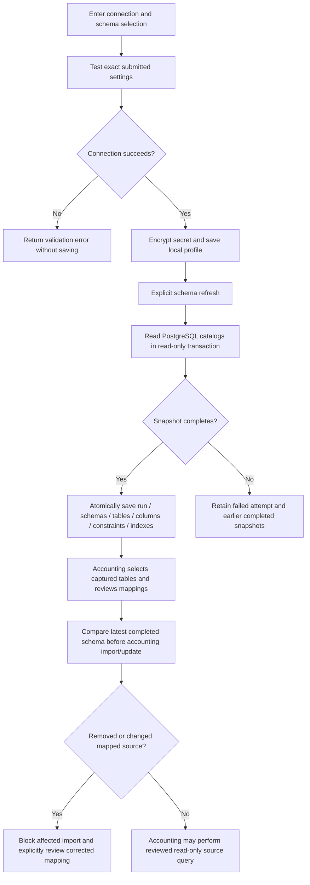
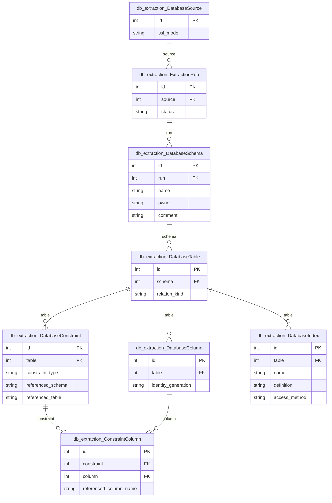

# PostgreSQL schema extraction

Owns encrypted connection profiles and versioned PostgreSQL structure snapshots used
by accounting mapping. This app captures metadata, not copies of external business
rows. The shared accounting query/import layer performs separately reviewed source reads.

## Application flow



## Schema drift and consumers

`services/schema_comparison.py` checks the mapped source projection against the latest
completed snapshot: removed tables/columns, type and financial-precision changes,
nullability, ordered primary keys and database identity. Names are not guessed when
a column disappears. Refresh metadata explicitly after external schema changes, select
the current table snapshot, correct the mapping, validate again and confirm the update.
Signed accounting review receipts include the schema revision. This app does not
silently retarget a mapping or rewrite prior snapshots.

See [Record First setup](../accounts_receivable/SETUP.md) and the
[reviewed migration guide](../accounts_receivable/DATABASE_MIGRATION.md) for business-row
queries and atomic local accounting writes. The existing connection/credential guide
below remains applicable.

## Tests

```bash
python auditcounter_django/manage.py test db_extraction accounts_receivable.test_data_quality --noinput
```

Tests use disposable local data and mocked source reads. Any live source integration
needs separately configured read-only PostgreSQL credentials; keep those and the
credential encryption key out of Git. No application login is required.

## Model ERD

These logical diagrams reflect the current Django model definitions. Key fields are
shown; external entities appear as primary-key stubs and include their app prefix.
`||` means exactly one, `|o` / `o|` zero or one, and `o{` / `}o` zero or more.
FK optionality is represented on the parent side; one-to-one/unique FKs limit children.
Many-to-many lines represent Django-managed join tables; service validation may impose
stronger business constraints than these structural cardinalities.

### Application models



### Model responsibilities

| Model | Responsibility |
|---|---|
| `DatabaseSource` | Encrypted external PostgreSQL connection profile. |
| `ExtractionRun` | One independent metadata snapshot attempt. |
| `DatabaseSchema` | Schema captured in a particular run. |
| `DatabaseTable` | Table/view metadata captured within a schema. |
| `DatabaseColumn` | Column types, nullability, defaults and related metadata. |
| `DatabaseConstraint` | Primary/foreign/unique/check constraint metadata. |
| `ConstraintColumn` | Ordered membership of columns in a captured constraint. |
| `DatabaseIndex` | Captured index definition and attributes. |

For every field, delete policy, conditional constraint and index, consult
[`models.py`](models.py) and the additive [`migrations/`](migrations/). These diagrams
do not imply that an unmigrated database already has the same schema.

## Detailed operating guide

Manage multiple PostgreSQL connections at `/databases/`. The workspace shares the
Falcon layout and navigation with Document Extraction and opens directly without
a login or admin account. Connection profiles live in the application database;
there are no source connection settings in `.env`.

## Setup

Install the root requirements using the application's virtual environment:

```sh
python -m pip install -r requirements.txt
cd auditcounter_django
python manage.py init_db_credential_key
python manage.py migrate
python manage.py runserver
```

The relevant packages are **Django**, **psycopg[binary]** (Psycopg 3), and
**cryptography**. They are already in the root requirements. There are no new
Python dependencies, JavaScript build dependencies, or task queue requirements.
The source server must be PostgreSQL 14 or newer; live integration was verified
against PostgreSQL 17. The application database remains Django's configured DB.

Open `/databases/` or choose **Database connections** in the sidebar. Django admin
at `/admin/` is optional and uses a separately created staff account.
On Ubuntu, provision the key under the same user
that runs `bizmatic.service`, apply migrations, collect static files, and restart
the application after deployment. Retain the existing Nginx static-file setup.

## Connection and refresh workflow

1. Add a connection with its host, port, database, username, password, SSL mode,
   optional CA certificate, connection timeout, and optional schema selection.
2. **Test connection** checks the entered settings without saving a profile.
   **Test and save connection** always tests the exact submitted settings again.
   Editing through Django admin uses the same form and verification.
3. **Refresh schema** captures an independent snapshot. Browse table/view names,
   columns, types, nullability, defaults, identity and generated expressions,
   comments, foreign keys, ordered composite keys, constraints, and index SQL.
4. **Extraction history** retains both successful and failed attempts. A failed
   refresh leaves the previous completed snapshot visible. Editing connection
   settings does not mutate previously captured metadata.
5. **Delete connection** shows a confirmation and permanently removes the saved
   connection, runs, and all their local metadata. It never deletes or changes
   the connected PostgreSQL database. Active refreshes block deletion until they
   finish; interrupted attempts older than ten minutes may be retried/deleted.

The MVP performs refresh synchronously in the web request, with connection
and per-query timeouts. Large catalogs can require a longer reverse-proxy and
application request timeout. A terminated request may leave a running attempt;
retry after ten minutes to mark it interrupted and start a fresh snapshot.
Snapshots are saved atomically; partial metadata is rolled back on failure.
Concurrent refreshes are serialized per connection on PostgreSQL application DBs.
SQLite application databases are suitable for development, not concurrent workers.

Only **structure** is extracted. The extractor reads PostgreSQL catalogs and
`information_schema`, never source table/view rows or sample business records.
It uses a read-only, repeatable-read transaction. Use a dedicated account with
CONNECT on the source database and USAGE on the selected schemas; metadata
visibility follows PostgreSQL permissions. Full formatted column types are
captured from catalogs; optional information-schema length/precision fields may
be unavailable when the account lacks privileges on the relation. No write or
superuser privileges are required.

Empty schema selection means all accessible non-system schemas. Explicit schema
names must exist and be accessible. Foreign-key target names are retained even
when their schema is outside the selected scope. A newer snapshot reflects
added, altered, or dropped objects without overwriting earlier snapshots.

## Credential storage

Passwords use Fernet authenticated encryption and are masked in forms. Blank
password edits preserve the existing password only while the host, port, database,
username, SSL mode and CA certificate are unchanged. After changing those settings,
enter the password again or choose **Clear saved password** before testing or saving.
Profiles without a saved password can still use passwordless connections.
The key is stored outside the repository and database at
`~/.config/bizmatic/db-extraction.key`, permissions `0600`.
`DB_EXTRACTION_CREDENTIAL_KEY_FILE` in Django settings can select a separately
provisioned file. Every application worker must have access to the same key.
This does not use `.env` for source credentials.

`init_db_credential_key` preserves an existing key. Back it up securely and restore
that exact key with database backups. Never generate a replacement if the original
is lost. Missing/wrong keys fail clearly; authorized application code can decrypt
credentials when connecting. Anyone who can reach the workspace can manage all
database profiles and saved metadata. Deploy it on a trusted network or restrict
access at the hosting layer. POST actions still require CSRF verification.

Migration `0002` encrypts legacy plaintext without deleting profiles and cannot
be reversed into plaintext storage. Legacy backups may still contain plaintext.
It also adds unique constraint names per captured table; resolve old duplicates
before migrating. Django fixture exports of source credentials are disabled;
use database backups with a separately protected key instead.

## File organization

- `models.py`, `fields.py`, `credentials.py`: metadata and encrypted storage.
- `forms.py`: source configuration and mandatory connection verification.
- `services/postgres.py`: bounded read-only catalog queries.
- `services/extraction.py`: snapshot persistence, recovery, local deletion.
- `services/pages.py`: filters, pagination, metadata totals.
- `views.py`, `urls.py`: direct workspace access, CSRF-protected actions, page handlers.
- `templates/db_extraction/`, `static/db_extraction/`: Falcon pages and form state.
- `tests.py`, `test_workflows.py`: credential, migration, access, and workflow checks.

Run the automated checks from the repository root with an isolated SQLite DB:

```sh
DB_ENGINE=django.db.backends.sqlite3 DB_NAME=:memory: .venv/bin/python auditcounter_django/manage.py test document_extraction db_extraction
```

Catalog implementation references:
[PostgreSQL catalogs](https://www.postgresql.org/docs/current/catalogs.html),
[constraints](https://www.postgresql.org/docs/current/catalog-pg-constraint.html),
[Psycopg connections](https://www.psycopg.org/psycopg3/docs/api/connections.html).
