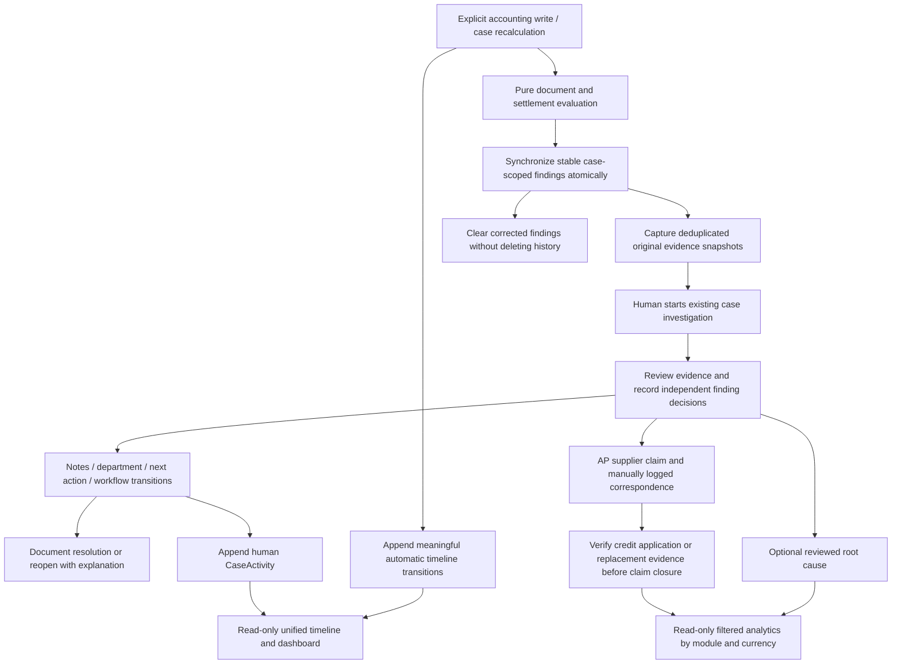
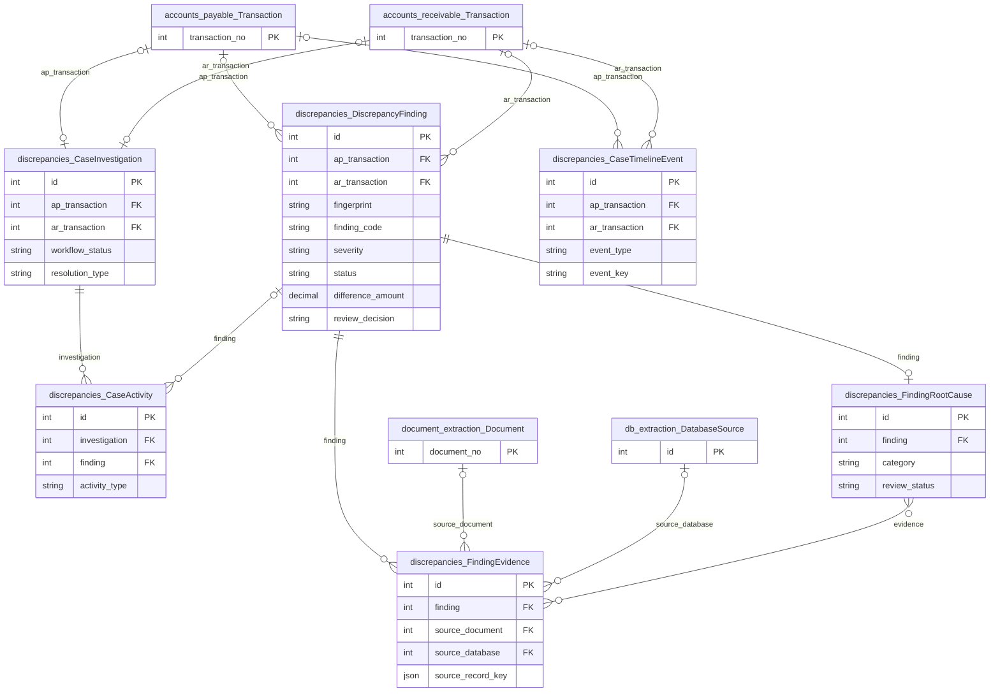
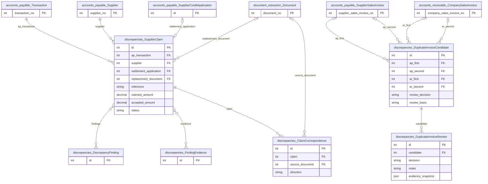

# Discrepancies, investigations and evidence

Shared AP/AR infrastructure for persistent findings, source snapshots, human
investigation, supplier claims, chronological evidence and reviewed outcome analytics.
It extends existing accounting `Transaction` cases rather than replacing them.

## Application flow



## Setup and operation

```bash
python auditcounter_django/manage.py migrate
python auditcounter_django/manage.py runserver 127.0.0.1:8000
```

Open `/discrepancies/` to search existing AP and AR cases. Open a case's original
accounting detail page to inspect findings, source documents, settlement, investigation
and timeline. Dashboard and timeline GETs do not recalculate or persist accounting
state. No login is required; retain the existing CSRF protection for writes.

1. Save matching/source changes or use explicit recalculation to evaluate current data.
2. Start an investigation; confirm, dismiss or request more evidence for individual
   findings. A manual staff label is optional and explicitly unverified.
3. Record notes, responsible department, next action and allowed workflow transitions.
4. Resolve with a documented type, explanation and supporting references when required.
   Reopen closed work with a reason; earlier resolutions and activities remain.
5. For AP, create a claim from current confirmed findings, prepare a copyable draft,
   manually log communications, and verify actual applied credit or replacement evidence.
6. Attribute root causes only after reviewing current evidence. Changed evidence flags
   earlier attributions or contradicted claim resolutions for renewed review.

## State and financial rules

| State | Meaning / authority |
|---|---|
| Reconciliation `pending`, `partial`, `matched`, `exception` | Computed accounting evidence result on the existing AP/AR case |
| Finding `open`, `cleared` | Whether a deterministic discrepancy remains detected |
| Finding review | `unreviewed`, `confirmed`, `dismissed`, `needs_more_evidence`; human decision |
| Investigation | `needs_review`, `investigating`, `waiting`, `resolved`, `dismissed`; human workflow |
| Root cause | Human-confirmed attribution or `needs_review` after supporting basis changes |

Do not assign one state from another. Investigation/claim closure does not mark a
physical discrepancy matched, clear a finding, or establish cash recovery. Findings
can describe overlapping arithmetic errors; financial summaries use persisted case
differences, not sums of finding amounts. Currencies and AP/AR are separate namespaces.

Finding identity uses a stable fingerprint, not a changing amount. Repeated unchanged
refreshes do not duplicate findings, evidence or automatic events. Legitimate recurring
transitions remain historical. `CaseActivity` and automatic events are append-only.
Timeline aggregation reuses human activities and available historical timestamps;
it does not invent pre-tracking observations. Duplicate invoice candidates can exist
without a case and never automatically delete or reject source invoices.

## Services and APIs

| Module / route | Purpose |
|---|---|
| `services/__init__.py`, `evaluation.py` | Pure finding results, atomic synchronization, evidence snapshots and deferred batch refresh |
| `services/investigation.py` | Locked, revision-checked reviews, notes, resolution and reopening |
| `services/timeline.py` | Idempotent automatic transitions and read-only historical aggregation |
| `services/dashboard.py`, `presentation.py` | Bounded shared case queries, filters and serialization |
| `services/duplicate_invoices.py` | Bounded candidate detection and historical human review |
| `services/claims.py`, `services/analytics.py` | Supplier claim workflows and reviewed cause/outcome aggregates |
| `GET /discrepancies/api/cases/`, `api/summary/` | Unified case list and filter-aware summary |
| `GET /discrepancies/api/cases/<ap-or-ar>/<id>/timeline/` | Category-filtered chronological timeline, bounded pagination |
| `GET /discrepancies/api/duplicate-invoices/` | Suspected invoice pairs with review history |
| `POST /discrepancies/api/duplicate-invoices/<id>/review/` | Explicit candidate review with revision and explanation |
| `GET /discrepancies/api/analytics/` | Module, party, dates, currency, finding, root-cause and investigation filters |

Investigation, finding-review, claim and `root-cause-review/<case_id>` writes use the
existing `/accounts-payable/api/` or `/accounts-receivable/api/` actions in shared
`accounts_receivable/services/http.py`. Read APIs validate filters and use bounded page
sizes. Writes reuse account/case locks, atomic operations, revisions and evidence scope.
Source record identifiers inside `FindingEvidence` are generic references; its explicit
document/database FKs and preserved JSON identify the source without fabricated OCR coordinates.

## Tests and limits

```bash
python auditcounter_django/manage.py test discrepancies accounts_payable accounts_receivable --noinput
node --test auditcounter_django/accounts_receivable/frontend_tests/*.test.cjs
```

PostgreSQL is required for independent-connection locking tests. Existing historical
data remains readable, but observations predating tracking may be incomplete. Supplier
correspondence is manually recorded; no email is sent. Cash refunds/recovery tracking,
exchange-rate conversion, assignment/approval hierarchies and background workers are
outside the MVP. See [implementation notes](../../docs/mvp-implementation-report.md)
and the [exact feature inventory](../../docs/mvp-file-inventory.md).

## Model ERD

These logical diagrams reflect the current Django model definitions. Key fields are
shown; external entities appear as primary-key stubs and include their app prefix.
`||` means exactly one, `|o` / `o|` zero or one, and `o{` / `}o` zero or more.
FK optionality is represented on the parent side; one-to-one/unique FKs limit children.
Many-to-many lines represent Django-managed join tables; service validation may impose
stronger business constraints than these structural cardinalities.

### Findings and investigation history



### Duplicate review and supplier claims



### Model responsibilities

| Model | Responsibility |
|---|---|
| `DiscrepancyFinding` | Stable case-scoped deterministic finding and independent human review. |
| `FindingEvidence` | Deduplicated immutable source observations and finding snapshots. |
| `CaseInvestigation` | Human workflow for exactly one existing AP or AR case. |
| `CaseActivity` | Append-only investigation notes, transitions, reviews and resolutions. |
| `CaseTimelineEvent` | Append-only automatic business transitions; existing human activity is aggregated separately. |
| `DuplicateInvoiceCandidate` | Ordered AP or AR invoice pair, including candidates outside a reconciliation case. |
| `DuplicateInvoiceReview` | Historical detection/clearance and human review snapshots. |
| `SupplierClaim` | AP claim backed by reviewed findings/evidence and protected settlement references. |
| `ClaimCorrespondence` | Manually logged supplier correspondence; messages are not sent automatically. |
| `FindingRootCause` | Current reviewed cause with selected evidence; prior decisions remain CaseActivity. |

For every field, delete policy, conditional constraint and index, consult
[`models.py`](models.py) and the additive [`migrations/`](migrations/). These diagrams
do not imply that an unmigrated database already has the same schema.
