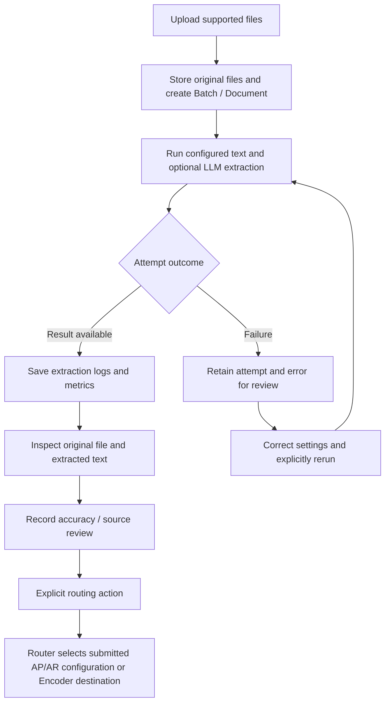
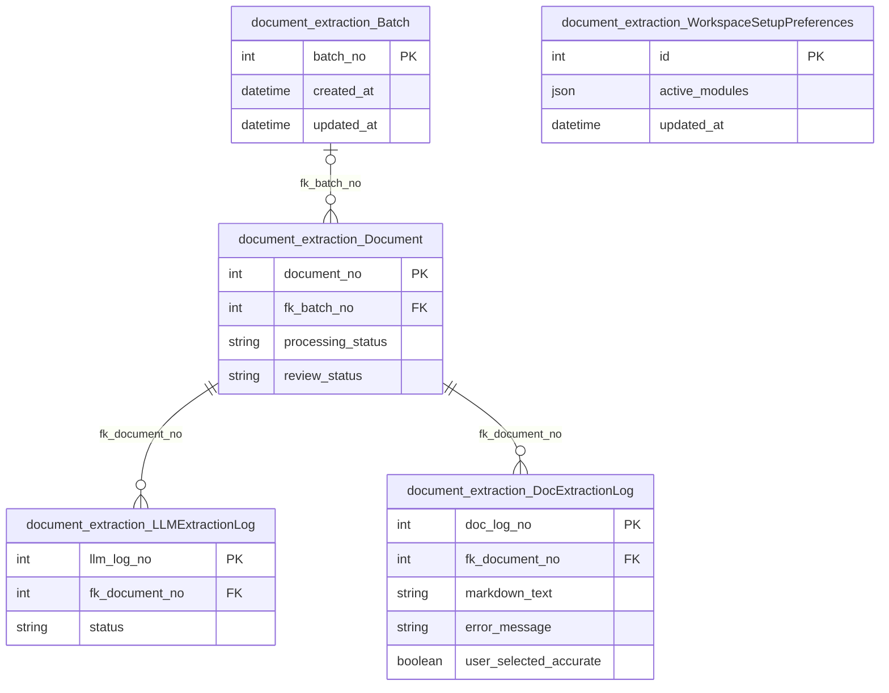

# Document extraction

Owns original uploaded documents, batch organization, text/LLM extraction attempts,
accuracy feedback and human source review. It also provides the shared base template,
original-file preview and provider transport used by the accounting and routing apps.

## Application flow



## Start and operate

From the repository root, create the environment and install the pinned requirements
as described in the [project README](../../README.md). Then:

```bash
python auditcounter_django/manage.py migrate
python auditcounter_django/manage.py runserver 127.0.0.1:8000
```

Configure `auditcounter_django/.env` from [.env.example](../.env.example). Use
`LOCAL_FILE_STORAGE_PATH` for original-file storage and `DOC_EXTRACTION_*` for the
provider/model, endpoints, concurrency and timeout. Restart Django after changes.
A plain text extraction path and provider-specific image/OCR support depend on the
installed parsers and configured model; inspect an attempt's error before retrying.

1. Open `/documents/upload/`, upload a supported source and inspect `/batches/`.
2. Open `/documents/<id>/` to preview the original and compare saved extraction outputs.
3. Record source review and extraction accuracy independently. Editing saved Markdown
   requires a current revision; it does not rewrite the original uploaded file.
4. Route a usable extraction explicitly. Human routing review and accounting extraction
   status are separate; inspect [Router](../router/README.md) for handoff behavior.
5. For failed/interrupted work, inspect prior results and use the document or batch
   rerun action. Successful sibling results and attempt history remain available.

## Services and integration

| Component | Responsibility |
|---|---|
| `services/uploads.py`, `storage.py` | Store originals, register batches/documents and orchestrate extraction |
| `services/documents.py`, `images.py`, `parser_limits.py` | Supported parsing, image preparation and bounded parser behavior |
| `services/llm.py` | Shared native-provider transport and extraction result metadata |
| `services/records.py` | Reviewed edits, accuracy feedback, source review and deletion guards |
| `services/originals.py`, `pages.py` | Original-file delivery, preview context and read models |
| `schemas/`, `utils/`, `util.py` | Structured inputs and shared compatibility helpers |
| `templates/document_extraction/base.html` | Shared navigation, branding and layout |

GET/HEAD views read stored state. Uploads, edits, reviews, provider calls and reruns
use explicit CSRF-protected writes. Document processing, source review and log
accuracy are distinct states. Provider calls run in the request; there is no queue.
Never commit uploaded business files, extracted content, credentials or local logs.
The trusted local MVP workspaces do not require an application login.

## Validation and troubleshooting

- Verify the selected provider/model, storage permissions and input limits when an
  extraction fails. Tests mock providers; they do not establish live provider availability.
- Back up original storage together with the application database. An extraction log
  is not a replacement for its source document.
- PDF preview problems involving `.mjs` MIME types are documented in the project README.
- Run `python auditcounter_django/manage.py test document_extraction --noinput`.

## Model ERD

These logical diagrams reflect the current Django model definitions. Key fields are
shown; external entities appear as primary-key stubs and include their app prefix.
`||` means exactly one, `|o` / `o|` zero or one, and `o{` / `}o` zero or more.
FK optionality is represented on the parent side; one-to-one/unique FKs limit children.
Many-to-many lines represent Django-managed join tables; service validation may impose
stronger business constraints than these structural cardinalities.

### Application models



### Model responsibilities

| Model | Responsibility |
|---|---|
| `Batch` | Groups uploaded documents and rerun operations. |
| `Document` | Original file identity, storage location, processing and human review state. |
| `LLMExtractionLog` | Saved provider text/result, token usage, duration, error and accuracy feedback. |
| `DocExtractionLog` | Saved text-extraction result, errors and accuracy feedback. |
| `WorkspaceSetupPreferences` | Workspace-wide setup reminders; no user identity or permissions. |

For every field, delete policy, conditional constraint and index, consult
[`models.py`](models.py) and the additive [`migrations/`](migrations/). These diagrams
do not imply that an unmigrated database already has the same schema.
