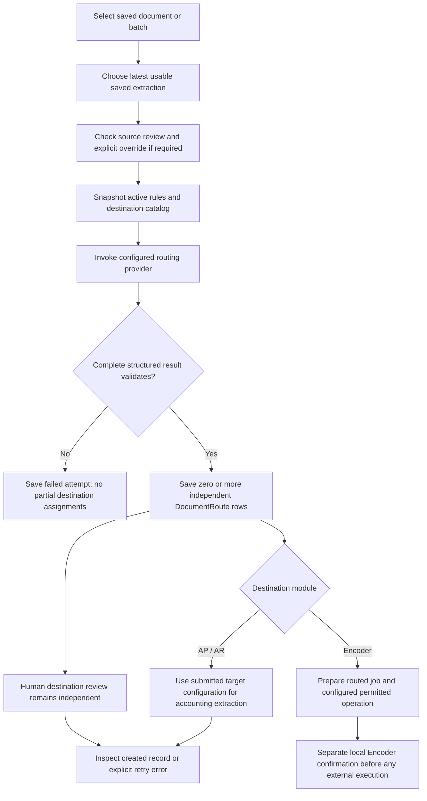
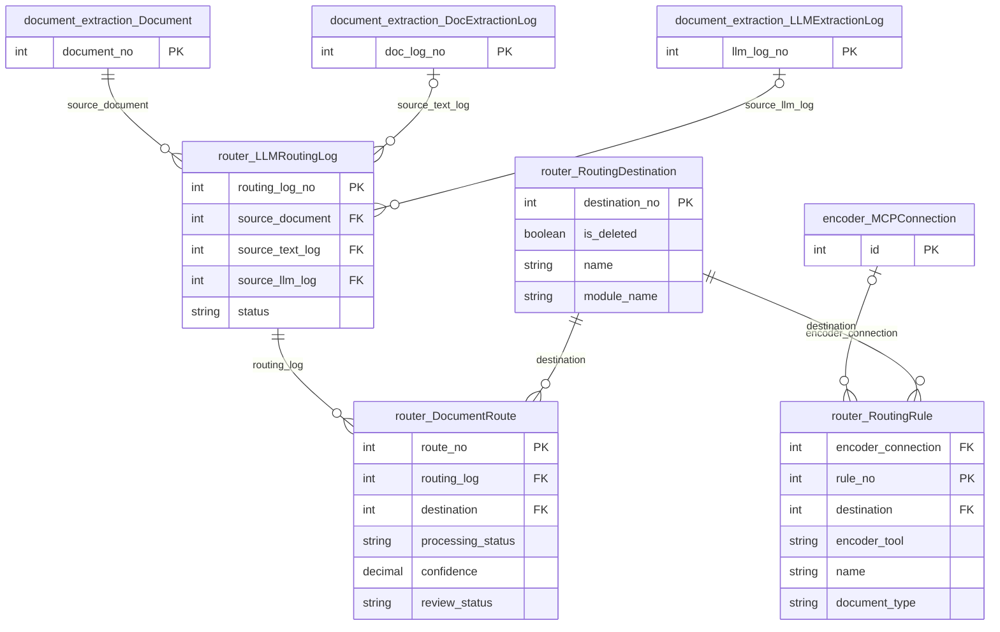

# Document routing

Owns rule-based destination configuration, LLM routing attempt history and independent
human destination reviews. It consumes saved extracted text rather than re-running OCR.
The existing detailed routing/retry guide is retained below.

## Application flow



## Model and runtime boundaries

`RoutingDestination` is a module/model destination; `RoutingRule` supplies matching
instructions. `LLMRoutingLog` snapshots exact source text and rules. `DocumentRoute`
records a single destination review and handoff outcome. A successful automatic handoff
is not human approval. Completed processing is idempotent; explicit retry is needed
after an inspected failure. Rerouting preserves earlier attempts.

All provider calls, configuration changes and reviews use CSRF-protected POSTs.
GET screens are read-only and require no application login. Provider configuration
uses `ROUTER_*` and the shared `document_extraction.services.llm` transport.
No background worker is introduced. See [accounting](../accounts_receivable/README.md)
and [Encoder](../encoder/README.md) for downstream operations.

## Tests

```bash
python auditcounter_django/manage.py test router --noinput
node --test auditcounter_django/router/frontend_tests/*.test.cjs
```

## Model ERD

These logical diagrams reflect the current Django model definitions. Key fields are
shown; external entities appear as primary-key stubs and include their app prefix.
`||` means exactly one, `|o` / `o|` zero or one, and `o{` / `}o` zero or more.
FK optionality is represented on the parent side; one-to-one/unique FKs limit children.
Many-to-many lines represent Django-managed join tables; service validation may impose
stronger business constraints than these structural cardinalities.

### Application models



### Model responsibilities

| Model | Responsibility |
|---|---|
| `RoutingDestination` | Configured accounting or Encoder destination. |
| `RoutingRule` | Human-configured matching instruction and optional Encoder operation. |
| `LLMRoutingLog` | Input/rules/provider snapshot and routing attempt outcome. |
| `DocumentRoute` | One independently reviewed destination decision and processing state. |

For every field, delete policy, conditional constraint and index, consult
[`models.py`](models.py) and the additive [`migrations/`](migrations/). These diagrams
do not imply that an unmigrated database already has the same schema.

## Detailed operating guide

Routing reads saved extraction text, evaluates active human-configured rules with
one LLM, and saves zero, one, or multiple `DocumentRoute` decisions per attempt.
Each successful LLM match automatically invokes AP/AR accounting extraction using
the one submitted module-wide document configuration for its target. Human review
remains pending; extraction does not record a human approval. The exact source is
retained in `route.routing_log.input_text`.
`services/handoff.py` saves per-route processing status, errors, and completion;
completed routes are not processed twice. See the [accounting guide](../accounts_receivable/README.md).

Encoder rules additionally select an enabled MCP connection and permitted operation.
Routing snapshots these settings and passes the matched rule's operation to Encoder.
The handoff prepares mappings, validates a local draft and, when values are missing,
starts contextual AI preparation/troubleshooting with persisted LLM usage. The job
workspace shows the routed operation without asking for it again. External MCP
execution still requires source/route approval and explicit payload confirmation.
Legacy rules without a selected operation retain manual drafts until edited/saved.
If several Encoder rules use different operations, the LLM must return the matching
`rule_no` as `rule_id`; unknown IDs fail validation and ambiguous selections stop
for review. AP/AR handoff behavior is unchanged.

## Run

1. Apply schema changes with `python manage.py migrate router`.
2. Set the router section in `.env` and restart Django.
3. Add destinations at `/router/destinations/`. Choose AP or AR, then select one of its supported extraction targets.
4. Add active rules explaining when each destination applies and when to exclude it.
5. Use Route document, Route selected, or Route batch in the document workspace.
6. Review the saved destinations and the LLM attempt log in `/router/`.

Source documents must have successful nonempty extracted text and must not be
currently extracting. The most recently saved extraction marked accurate is
preferred; otherwise the most recently saved usable extraction is selected.
Alternate OCR outputs are never concatenated. Input text is never truncated.

Pending and rejected source reviews require the explicit second confirmation.
The server checks saved reviews and revisions again, including every document in
a batch. A changed selection or review returns a fresh confirmation without
starting any calls. Routing does not change the source review or processing state.

## Files

- `models.py`: destinations, rules, LLM attempts, and independent destination reviews.
- `forms.py`: module and target choice validation, including installed model checks.
- `services/catalog.py`: the AP/AR extraction targets shared by the selectors and server validation.
- `schemas/routing.py`: browser execution request and LLM JSON response validation.
- `services/execution.py`: source selection, snapshots, concurrency, and saved results.
- `services/llm.py`: router settings, prompt, native provider payloads, and response parsing.
- `services/configuration.py`: configuration writes and revision checks.
- `services/records.py`: route review, manual destinations, and accuracy feedback.
- `services/handoff.py`: automatic accounting execution, approval, and explicit failed retries.
- `services/pages.py`: database reads and the JSON used by the existing screens.
- `views.py`, `urls.py`: GET screens and CSRF-protected POST handlers.
- `static/router/`: configuration, review, and history interactions; no browser fixtures.
- `document_extraction/static/document_extraction/routing.js`: execution confirmations.

The shared transport is `document_extraction/services/llm.py`. Router overrides
use the `ROUTER_` environment prefix and the same provider sections as document
extraction. `ROUTER_LLM_PROVIDER` selects one provider, and the corresponding
`ROUTER_OPENAI_MODEL`, `ROUTER_ANTHROPIC_MODEL`, `ROUTER_GOOGLE_MODEL`,
`ROUTER_OLLAMA_MODEL`, `ROUTER_ALIBABA_MODEL`, or `ROUTER_DEEPSEEK_MODEL`
selects its model. Blank credentials and API URLs reuse the
corresponding `DOC_EXTRACTION_` values. Prompts, input text, rules, native request
and response payloads, tokens, timing, source extraction IDs, and any source-review
override are stored in `LLMRoutingLog`. API credentials stay in the HTTP headers.

Like document extraction, execution runs within the triggering HTTP request with
bounded asynchronous concurrency. Configure the server/proxy request timeout for
the chosen batch size and provider latency. Each document has a separate attempt,
and failures leave successful sibling results and previous attempts intact.
Request IDs make retries idempotent; a database constraint prevents overlapping
active attempts for the same source document. A terminated worker can leave an
active attempt requiring an administrator to mark it failed before retrying.

LLM output is accepted only when its complete JSON validates, each destination is
in the rule snapshot, and IDs are unique. No match is a completed attempt with no
routes. Malformed output, truncation, and provider failures are saved as failed
attempts with no partial route assignments.

Destination reviews start pending while accounting extraction runs automatically.
Missing or ambiguous configurations and extraction failures are saved on the route;
approve the route, select a submitted configuration if necessary, and use Process
record to retry. A request replay does not restart extraction or failed routes.
Document review and attempt log pages also offer Retry extraction for pending or
failed routes, with an optional submitted configuration selection. This explicit
retry preserves human review status and skips completed routes. Rejected, stale,
or superseded routes cannot be retried.
Use Rerun routing on either page to classify the latest saved text again using
current rules, retaining the previous attempt. Unapproved source documents need
explicit confirmation. Routing cannot restart while AP/AR extraction is running.
An interrupted rerun dialog reuses its request ID when retried.
Manually added destinations still start extraction when approved.
Stale source documents and superseded attempts
cannot receive new review decisions or manual destinations. Module/model identities
with routing history cannot be retargeted; create another destination instead.

Queue and LLM list screens show the latest 500 records, with client pagination and
filters. A source document's Routing history link provides its complete attempts.
Tests use a disposable database and mocked LLM calls; no test data is seeded into
the normal application database.

Destination choices cover Supplier/Customer, purchase orders, delivery receipts,
sales invoices, and payments. Changing the module clears the target selection.
Existing destinations outside the current catalog retain their saved identity
when edited; add new supported modules in `services/catalog.py` as they become ready.

## Delete routing configuration

Delete opens a confirmation naming the destination or rule. For destinations,
the warning explicitly states that ALL associated routing rules will also be
deleted. Confirmation removes the destination and rules together in one
transaction. It is a CSRF-protected POST and checks the current record revision.

Past rule snapshots, routes, source documents and AP/AR or Encoder records are
retained. Deleted destinations are kept as inactive historical references, hidden
from configuration, and cannot be re-enabled or edited through the UI. A new
destination for the same module/model may be created with a fresh identity.
