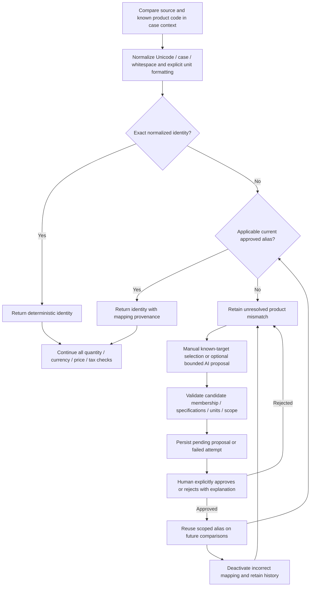
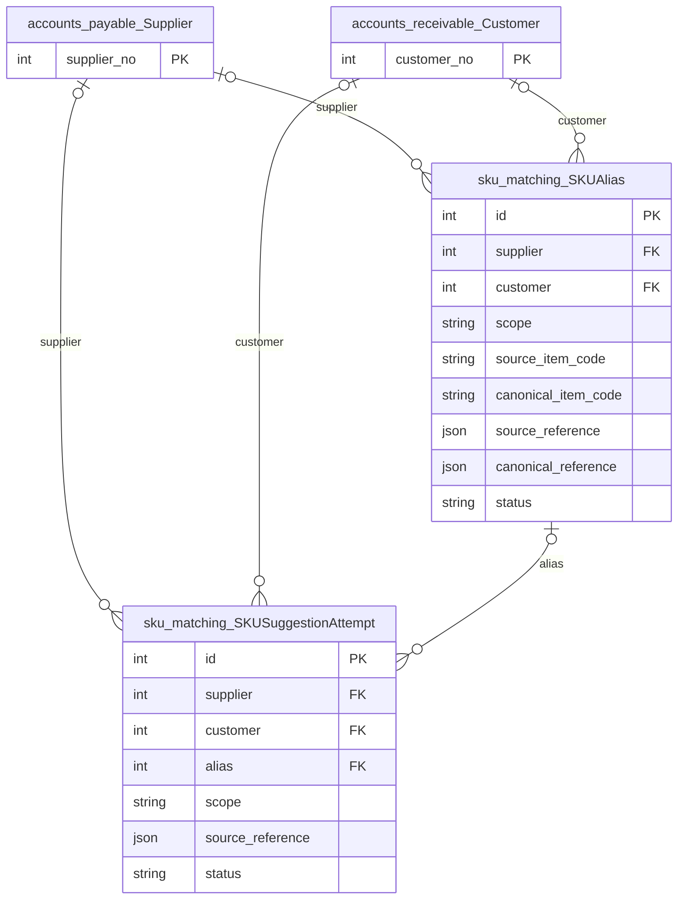

# SKU normalization and reviewed equivalences

Shared product-identity resolution for manual and automatic AP/AR matching. Exact or
deterministically normalized codes can match directly; different codes require an
applicable approved alias. Optional AI proposals always require human approval.

## Application flow



## Setup and use

Apply the project migrations, start the existing accounting workspace and open a case's
matching page at `/accounts-payable/reconciliation/<id>/match/` or its AR equivalent.
The SKU assistance panel uses the case account, source namespace, unit and known
source line references. This app has no separate URL configuration or product-master UI.

```bash
python auditcounter_django/manage.py migrate
python auditcounter_django/manage.py runserver 127.0.0.1:8000
python auditcounter_django/manage.py test sku_matching accounts_payable accounts_receivable --noinput
```

Manual proposals and approved alias reuse do not require a provider. Optional
suggestions reuse `CONFIG_ASSISTANT_*`, the existing accounting JSON/schema helpers
and `document_extraction.services.llm` transport. Review configuration in
[.env.example](../.env.example); no new model transport or embedding/vector service
is needed. Provider failures leave deterministic matching available and record the
failed attempt. No provider calls are made by ordinary identity resolution.

## Identity and approval safeguards

- Preserve original codes and descriptions. Normalization uses Unicode normalization,
  case and whitespace handling; meaningful punctuation, model identifiers, leading
  zeros, capacity and voltage remain significant. No invented unit conversions.
- Resolve in order: exact/normalized equality, applicable current approved mapping,
  otherwise unresolved. Pending/rejected/deactivated proposals are not matching evidence.
- Scope aliases to AP supplier or AR customer, source namespace and normalized unit.
  Database constraints prevent conflicting approved mappings in the same scope.
- Canonical targets must reference known source records. JSON source/canonical references
  are validated by the service, not invented product foreign keys or new products.
- Bound candidate input, reject contradictory specifications, malformed responses and
  suggested identifiers outside the supplied candidates. AI confidence is not proof.
- Approval confirms product identity only. Party, currency, UOM, quantity capacity,
  duplicate-allocation, pricing, tax and discount validations continue independently.
- Deactivation preserves history and stops future resolution. Existing cases can be
  explicitly recalculated/reviewed; source accounting values are never overwritten.

## Services and API integration

| Component | Responsibility |
|---|---|
| `services/normalization.py` | Deterministic SKU/description/unit formatting and specification checks |
| `services/products.py` | Bounded known line candidates, account context and source references |
| `services/mapping.py` | Approved resolver, scoped catalog locks/revisions and review operations |
| `services/suggestions.py` | Structured optional AI proposal and candidate-response validation |
| `services/presentation.py` | Case matching panel data and preserved mapping history |
| `accounts_receivable/services/http.py` | Shared accounting POST actions |

Actions under the selected accounting module are `sku-mappings/<case_id>`,
`sku-suggest/<case_id>`, `sku-approve/<case_id>`, `sku-reject/<case_id>` and
`sku-deactivate/<case_id>`. They use CSRF-protected POST JSON and the existing case /
catalog revision protocol. Approve/reject/deactivate requests must identify a scoped
alias and include review notes; stale or conflicting decisions fail atomically.
Staff review does not require authenticated identity in this trusted local MVP.

## Troubleshooting and limits

Check account, source namespace, unit, known target snapshot and catalog revision if
an expected alias does not resolve. Changed targets need renewed review/deactivation.
Unknown codes remain unresolved until a human chooses supported evidence. No fuzzy
identity acceptance, automatic approval, external catalog enrichment, product creation,
ERP code rewrite or unit conversion is implemented. Tests mock AI calls and use
PostgreSQL for concurrency guarantees.

## Model ERD

These logical diagrams reflect the current Django model definitions. Key fields are
shown; external entities appear as primary-key stubs and include their app prefix.
`||` means exactly one, `|o` / `o|` zero or one, and `o{` / `}o` zero or more.
FK optionality is represented on the parent side; one-to-one/unique FKs limit children.
Many-to-many lines represent Django-managed join tables; service validation may impose
stronger business constraints than these structural cardinalities.

### Application models



### Model responsibilities

| Model | Responsibility |
|---|---|
| `SKUAlias` | Scoped pending/approved/rejected/deactivated product-code equivalence. |
| `SKUSuggestionAttempt` | Bounded known-candidate input, provider metadata and validated proposal/failure. |

For every field, delete policy, conditional constraint and index, consult
[`models.py`](models.py) and the additive [`migrations/`](migrations/). These diagrams
do not imply that an unmigrated database already has the same schema.
