# discrepancies ER diagram

Tables owned by `discrepancies` include all local fields. Referenced tables from other apps show only their primary key; see the [diagram index](../auditcounter-django-erd.md) for their full definitions. Relationships are shown in the diagram of the app that owns the foreign key.

```mermaid
erDiagram
    accounts_payable_supplier {
        AutoField supplier_no PK
    }
    accounts_payable_suppliercreditapplication {
        BigAutoField id PK
    }
    accounts_payable_suppliersalesinvoice {
        AutoField supplier_sales_invoice_no PK
    }
    accounts_payable_transaction {
        AutoField transaction_no PK
    }
    accounts_receivable_companysalesinvoice {
        AutoField company_sales_invoice_no PK
    }
    accounts_receivable_transaction {
        AutoField transaction_no PK
    }
    db_extraction_databasesource {
        BigAutoField id PK
    }
    discrepancies_caseactivity {
        BigAutoField id PK
        ForeignKey investigation_id FK
        CharField activity_type
        ForeignKey finding_id FK
        CharField previous_status
        CharField new_status
        TextField notes
        CharField actor_label
        JSONField details
        DateTimeField created_at
    }
    discrepancies_caseinvestigation {
        BigAutoField id PK
        OneToOneField ap_transaction_id FK
        OneToOneField ar_transaction_id FK
        CharField workflow_status
        CharField responsible_department
        TextField next_action
        CharField resolution_type
        TextField resolution_notes
        JSONField resolution_evidence
        CharField resolution_basis
        BooleanField review_required
        TextField review_reason
        DateTimeField opened_at
        DateTimeField updated_at
        DateTimeField closed_at
    }
    discrepancies_casetimelineevent {
        BigAutoField id PK
        ForeignKey ap_transaction_id FK
        ForeignKey ar_transaction_id FK
        CharField event_type
        CharField event_key
        CharField description
        DateTimeField occurred_at
        DateTimeField recorded_at
        CharField source_model
        CharField source_record_id
        JSONField details
        CharField evidence_snapshot_hash
    }
    discrepancies_claimcorrespondence {
        BigAutoField id PK
        ForeignKey claim_id FK
        CharField direction
        CharField subject
        TextField message
        DateTimeField occurred_at
        CharField actor_label
        ForeignKey source_document_id FK
        DateTimeField created_at
    }
    discrepancies_discrepancyfinding {
        BigAutoField id PK
        ForeignKey ap_transaction_id FK
        ForeignKey ar_transaction_id FK
        CharField fingerprint
        CharField finding_code
        CharField severity
        CharField status
        TextField summary
        JSONField expected_value
        JSONField actual_value
        DecimalField difference_amount
        CharField currency
        CharField rule_version
        JSONField identity
        JSONField details
        DateTimeField first_detected_at
        DateTimeField last_detected_at
        DateTimeField cleared_at
        CharField review_decision
        TextField review_notes
        DateTimeField reviewed_at
        CharField review_basis
    }
    discrepancies_duplicateinvoicecandidate {
        BigAutoField id PK
        ForeignKey ap_first_id FK
        ForeignKey ap_second_id FK
        ForeignKey ar_first_id FK
        ForeignKey ar_second_id FK
        BooleanField active
        JSONField details
        CharField review_decision
        TextField review_notes
        CharField review_basis
        DateTimeField created_at
        DateTimeField updated_at
    }
    discrepancies_duplicateinvoicereview {
        BigAutoField id PK
        ForeignKey candidate_id FK
        CharField decision
        TextField notes
        JSONField evidence_snapshot
        DateTimeField created_at
    }
    discrepancies_findingevidence {
        BigAutoField id PK
        ForeignKey finding_id FK
        CharField snapshot_hash
        CharField evidence_type
        CharField source_model
        CharField source_record_id
        CharField source_line_id
        ForeignKey source_document_id FK
        ForeignKey source_database_id FK
        JSONField source_record_key
        JSONField provenance
        CharField field_name
        JSONField observed_value
        JSONField finding_snapshot
        DateTimeField captured_at
    }
    discrepancies_findingrootcause {
        BigAutoField id PK
        OneToOneField finding_id FK
        CharField category
        TextField explanation
        CharField review_status
        DateTimeField reviewed_at
        CharField actor_label
        CharField finding_basis
        DateTimeField updated_at
    }
    discrepancies_findingrootcause_evidence {
        BigAutoField id PK
        ForeignKey findingrootcause_id FK
        ForeignKey findingevidence_id FK
    }
    discrepancies_supplierclaim {
        BigAutoField id PK
        ForeignKey ap_transaction_id FK
        ForeignKey supplier_id FK
        CharField reference
        CharField category
        CharField currency
        DecimalField claimed_amount
        DecimalField accepted_amount
        CharField status
        DateField submission_date
        DateField follow_up_date
        CharField resolution_type
        TextField resolution_notes
        OneToOneField settlement_application_id FK
        ForeignKey replacement_document_id FK
        BooleanField review_required
        DateTimeField closed_at
        DateTimeField created_at
        DateTimeField updated_at
    }
    discrepancies_supplierclaim_evidence {
        BigAutoField id PK
        ForeignKey supplierclaim_id FK
        ForeignKey findingevidence_id FK
    }
    discrepancies_supplierclaim_findings {
        BigAutoField id PK
        ForeignKey supplierclaim_id FK
        ForeignKey discrepancyfinding_id FK
    }
    document_extraction_document {
        AutoField document_no PK
    }
    discrepancies_caseinvestigation ||--o{ discrepancies_caseactivity : "investigation"
    discrepancies_discrepancyfinding o|--o{ discrepancies_caseactivity : "finding"
    accounts_payable_transaction o|--o| discrepancies_caseinvestigation : "ap_transaction"
    accounts_receivable_transaction o|--o| discrepancies_caseinvestigation : "ar_transaction"
    accounts_payable_transaction o|--o{ discrepancies_casetimelineevent : "ap_transaction"
    accounts_receivable_transaction o|--o{ discrepancies_casetimelineevent : "ar_transaction"
    discrepancies_supplierclaim ||--o{ discrepancies_claimcorrespondence : "claim"
    document_extraction_document o|--o{ discrepancies_claimcorrespondence : "source_document"
    accounts_payable_transaction o|--o{ discrepancies_discrepancyfinding : "ap_transaction"
    accounts_receivable_transaction o|--o{ discrepancies_discrepancyfinding : "ar_transaction"
    accounts_payable_suppliersalesinvoice o|--o{ discrepancies_duplicateinvoicecandidate : "ap_first"
    accounts_payable_suppliersalesinvoice o|--o{ discrepancies_duplicateinvoicecandidate : "ap_second"
    accounts_receivable_companysalesinvoice o|--o{ discrepancies_duplicateinvoicecandidate : "ar_first"
    accounts_receivable_companysalesinvoice o|--o{ discrepancies_duplicateinvoicecandidate : "ar_second"
    discrepancies_duplicateinvoicecandidate ||--o{ discrepancies_duplicateinvoicereview : "candidate"
    discrepancies_discrepancyfinding ||--o{ discrepancies_findingevidence : "finding"
    document_extraction_document o|--o{ discrepancies_findingevidence : "source_document"
    db_extraction_databasesource o|--o{ discrepancies_findingevidence : "source_database"
    discrepancies_discrepancyfinding ||--o| discrepancies_findingrootcause : "finding"
    discrepancies_findingrootcause ||--o{ discrepancies_findingrootcause_evidence : "findingrootcause"
    discrepancies_findingevidence ||--o{ discrepancies_findingrootcause_evidence : "findingevidence"
    accounts_payable_transaction ||--o{ discrepancies_supplierclaim : "ap_transaction"
    accounts_payable_supplier ||--o{ discrepancies_supplierclaim : "supplier"
    accounts_payable_suppliercreditapplication o|--o| discrepancies_supplierclaim : "settlement_application"
    document_extraction_document o|--o{ discrepancies_supplierclaim : "replacement_document"
    discrepancies_supplierclaim ||--o{ discrepancies_supplierclaim_evidence : "supplierclaim"
    discrepancies_findingevidence ||--o{ discrepancies_supplierclaim_evidence : "findingevidence"
    discrepancies_supplierclaim ||--o{ discrepancies_supplierclaim_findings : "supplierclaim"
    discrepancies_discrepancyfinding ||--o{ discrepancies_supplierclaim_findings : "discrepancyfinding"
```

