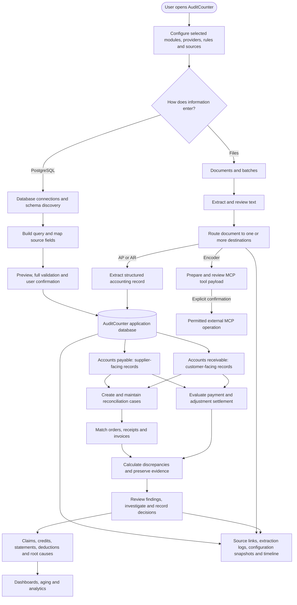
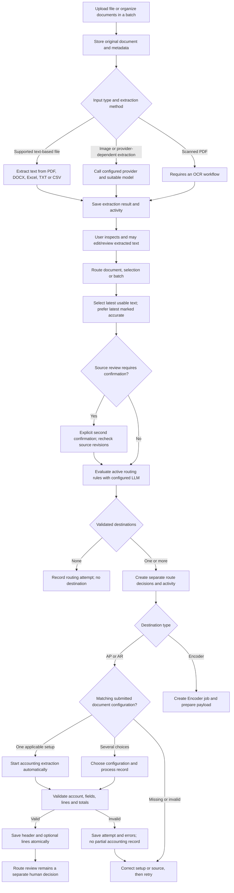
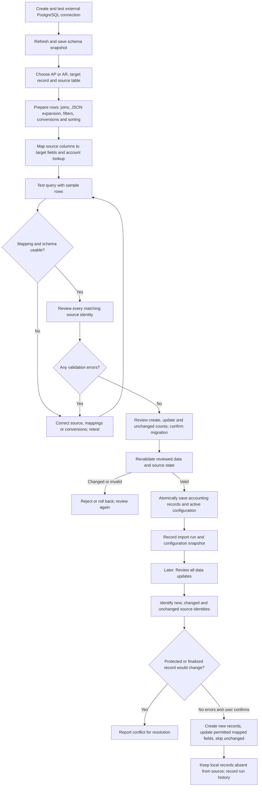
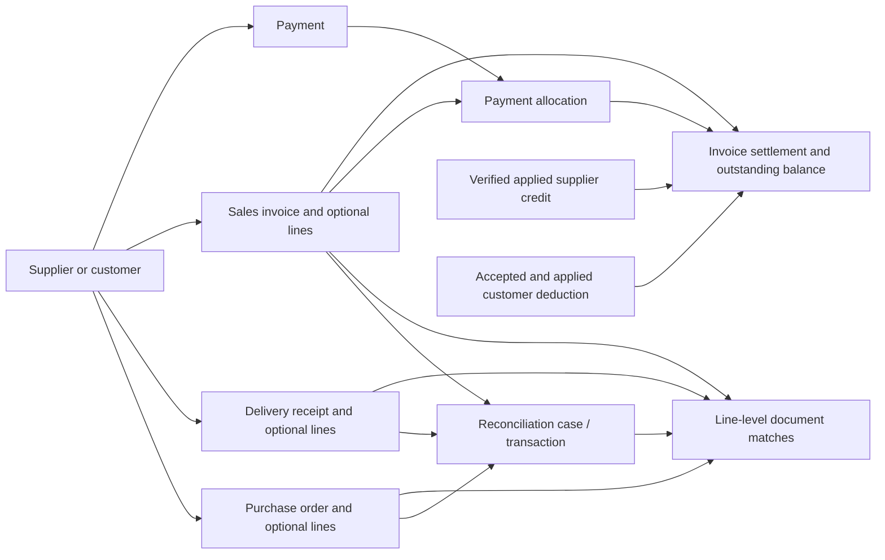
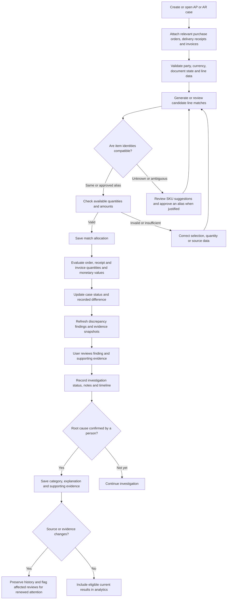
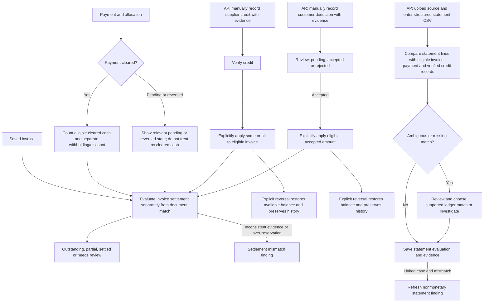
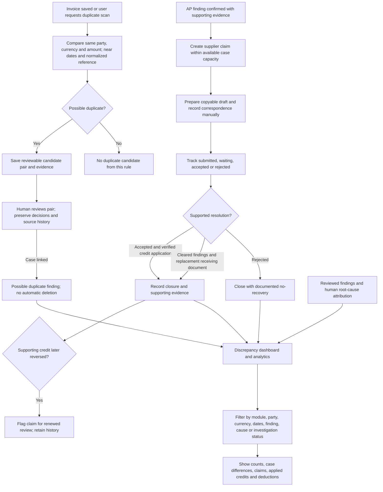
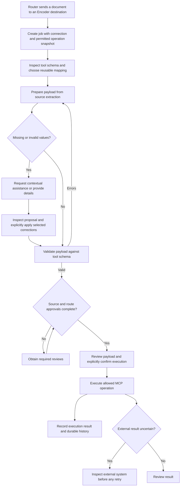

# How AuditCounter works: detailed functional flow

This guide describes the **current workspace code**, including uncommitted features. It is a map of implemented flows, not proof that a particular running instance has the latest migrations, settings, provider credentials, or data. Diagrams are split to keep them readable and avoid Mermaid's maximum text-size limit.

## 1. The whole system

AuditCounter maintains its **own application database**, distinct from any PostgreSQL source or external system. Documents and external database records are alternative ways to populate accounting records; either can be used without the other. AP and AR have separate models and rules, but share parts of the interface and service layer. The Router can send a document to more than one independent destination. The optional Encoder is a separate external-write path, not a prerequisite for reconciliation.

## 2. Document intake, extraction and routing

Routing **does not imply human approval**. An LLM-matched AP/AR route can start extraction while the route is still pending review. Completed routes are protected from repeat processing. Source text, attempt logs, errors and configuration snapshots provide traceability. Manually added destinations process on approval. Text-based parsing and provider extraction have different capabilities; a scanned PDF needs an appropriate OCR workflow. File size and parser limits are documented in the [project README](../README.md).

An AP/AR document configuration defines the target record, instructions, field rules and account lookup. A test is a preview; activation requires review and confirmation. The configuration assistant can suggest settings, but proposals must be applied and the configuration submitted separately. A document route normally produces one accounting header and its optional lines; split documents that contain multiple target invoices.

## 3. PostgreSQL setup, migration and later updates

Source queries use read-only transactions; migration writes to AuditCounter's application database, not the external PostgreSQL source. The complete migration is reviewed and then revalidated at confirmation. A failure during the commit rolls back the accounting and configuration changes. Updates preserve unmapped accounting fields and do not delete local records that disappear from the source. Records already used in reconciliation or otherwise protected can block changes. Schema drift checks use the latest **completed snapshot**, so refresh the schema to inspect recent external changes. See [database migration and updates](../auditcounter_django/accounts_receivable/DATABASE_MIGRATION.md) and the [query builder guide](../auditcounter_django/accounts_receivable/QUERY_BUILDER.md).

## 4. AP and AR accounting records

| Concept | Accounts payable | Accounts receivable |
| --- | --- | --- |
| Counterparty | Supplier | Customer |
| Order | Company purchase order | Customer purchase order |
| Delivery | Supplier delivery receipt | Company delivery receipt |
| Invoice | Supplier sales invoice | Company sales invoice |
| Payment | Company payment | Customer payment |
| Other adjustments | Supplier credit notes and applications | Customer deductions and applications |

A case groups related records for a party. It can link multiple orders, delivery receipts and invoices; partial deliveries and shared quantities require explicit capacity checks. Payment allocations are separate from line matching. Accounting amounts use decimal arithmetic. Only cleared payments contribute as cleared settlement; withholding and discounts are displayed separately. Currencies remain separate and there is no currency conversion.

## 5. Matching, findings and investigation

A match is not merely a text comparison: the system validates document state, item identity, quantities, amounts and available capacity. SKU normalization and approved aliases help relate different product codes; ambiguous matches need review. Line arithmetic is checked against quantity, unit price, discount and tax where the necessary values exist. Reconciliation uses a configured price tolerance, one cent by default. Findings and their evidence support investigation; they are not automatically proof of fraud or recoverable loss.

## 6. Settlement, credits, deductions and supplier statements

Matching and settlement answer different questions: matching compares business documents; settlement explains how an invoice balance is covered. A credit is not cash, and accepting a deduction alone does not adjust the invoice: an explicit application is required. Statement reconciliation compares recorded statement lines with the ledger; it does not apply credits or create payments. Current statement entry uses structured CSV plus an uploaded original, up to 500 rows; direct PDF/Excel statement parsing is not exposed.

## 7. Duplicate invoices, supplier claims and analytics

Duplicate detection is conservative: it compares normalized references and dates within three days for invoices with the same party, currency and recorded total. It may miss other duplicates and does not automatically delete anything. Claims and correspondence are manual; the application does not send email. Claim closure needs supported evidence. Analytics distinguish historical finding confirmations, current reviewed root causes, case differences and applied adjustments; they do not infer cash recoveries or sum individual findings as independent losses.

## 8. Optional Encoder and external operation

Encoder is disabled by default and documented as a trusted loopback development MVP. It can prepare and validate data without executing an external operation. AI suggestions must be inspected and applied explicitly; execution requires approvals and explicit payload confirmation. If the external outcome is uncertain, inspect the external system before retrying. See the [Encoder guide](../auditcounter_django/encoder/README.md).

## Practical example

1. A company uploads a supplier invoice and delivery receipt, extracts and reviews their text, and routes them to AP. Alternatively, it imports the corresponding records from a configured PostgreSQL source.
2. AuditCounter saves the supplier invoice and delivery receipt, including available line items and source links. The company purchase order is also present.
3. A user groups the documents into a case, reviews proposed line matches, and allocates quantities. If the order says 50 units but the receipt supports 48, the evaluation can retain the difference and create findings for review.
4. The user reviews the evidence, investigates and, if appropriate, creates a supplier claim. A supplier credit is recorded and verified; only an explicit application affects the invoice settlement. The claim can then be closed if its required evidence is satisfied.
5. A later payment allocation and cleared payment contribute to settlement independently of the document match. Dashboards and the timeline show the current state and preserved history.

## Operational boundaries

- Provider calls, reviews and imports can run within web requests; the project documentation describes no background queue or automatic retry. Large operations need suitable timeouts.
- The README states that the workspaces do not provide application-level authentication or organization isolation. Restrict access at the hosting layer.
- Several newer workflows are present in the current workspace and require their corresponding migrations on the target application database. This guide does not assert that they are deployed or enabled.
- Key implementation references: [document routing](../auditcounter_django/router/README.md), [AP/AR workflow](../auditcounter_django/accounts_receivable/README.md), [database migration](../auditcounter_django/accounts_receivable/DATABASE_MIGRATION.md), [Encoder](../auditcounter_django/encoder/README.md), and [new workflow implementation report](mvp-implementation-report.md).
